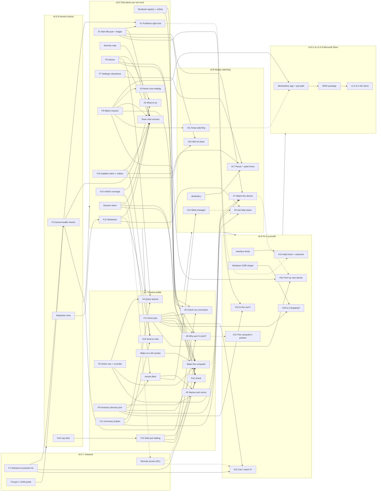

# netdiag roadmap

This is the master plan from v0.5.7 to v0.9, and on to the v1.0.0 Microsoft Store release. It was written on 2026-10-17. Code references were checked against `master` at `3f19d8f`. That commit is the v0.5.7 tag (`d69860a`) plus the v0.5.8 work committed so far.

Each release from v0.6 on has its own detailed plan:
- [v0.6 "Chat alerts you can trust"](v0.6.md)
- [v0.7 "Device toolkit"](v0.7.md)
- [v0.8 "Always watching"](v0.8.md)
- [v0.9 "Fix it yourself"](v0.9.md). Its section 13 covers the rest of 0.9.x: Microsoft Store readiness, ending in the **v1.0.0** Store release.
- [Code signing and Microsoft Store](signing-and-store.md): the background, costs and owner steps for Azure Artifact Signing and the Store.

v0.5.7 and v0.5.8 (both released) are small, so their lists live here in [section 4](#4-v057-and-v058-honest-checks-released).

## 1. Purpose and how to use this roadmap

This file is the one place that says what ships in which release, in what order, and why. The version plans hold the detail: click-by-click wording, files and functions, routes, tests and milestones. When this file and a plan disagree on a shared name, the [contract registry](#8-contract-registry) wins. Fix the plan.

**Working through a release**

1. Check the gate in the [release overview](#3-release-overview). Don't start a version until its gate is met.
2. Open the version plan and read:
   - section 1 (goal)
   - section 2 (scope)
   - section 3 (prerequisites)
   - section 10 (decisions)

   Settle every decision that the [Decision log](#12-decision-log) marks as needed by M1 before you start.
3. Read this file's section for that version. It lists corrections the plan still needs, for example where the code moved after the plan was written.
4. Work milestone by milestone, in the order of the plan's section 6. A milestone merges only when:
   - its acceptance check passes;
   - `go test ./...` and the Playwright suite are green;
   - CI on GitHub is green.

   Every milestone leaves netdiag usable.
5. Before starting a milestone, re-check its file:line references against the code, because line numbers drift. The plans use different bases:
   - v0.6 and v0.9: the pre-tag working tree;
   - v0.7: `d69860a`;
   - v0.8: `fc9bd90`.

   The v0.5.8 commits moved more lines. For example, `label()` in `internal/notify/notify.go` is now at `:120`, `Store.Previous` is at `internal/store/history.go:226`, `#drawer-remote` is at `web/index.html:349` and the "ten fixed ports" sentence is at `README.md:389`.
6. Tick the milestone's boxes in the plan. When a whole feature ships, tick it in the [Feature index](#7-feature-index) here.
7. Record every decision in the [Decision log](#12-decision-log), and every item moved from one version to another. Nothing moves between versions without an entry.
8. Release with the [standard steps](#13-release-process-and-definition-of-done).

**With Claude Code.** Start each working session like this:

> Open roadmap/README.md and roadmap/v0.7.md. We are on milestone M3. Read the v0.7 section and the contract registry in README.md first. Re-check M3's file and line references against the code, then implement only M3's tasks. Run M3's acceptance check, `go test ./...`, `GOOS=darwin go vet ./...` and `npx playwright test` in tools/uitest. Tick the boxes you finished in v0.7.md. Add any decision you had to make to the Decision log in roadmap/README.md. Stop at the end of the milestone.

Claude Code also follows these rules:
- Never kill processes by image name. Stop only the netdiag it started, by its path.
- Ask the user before a test that needs the Zebra's cover opened or closed.
- Commit, tag or push only when asked. Branch first when on `master`.
- Don't change a name listed in the contract registry without a Decision log entry.

**Status words.** Released, Next, In progress, Planned, Done. Checkboxes: `[ ]` is open, `[x]` is done.

**Links.** Links into the plans use GitHub heading anchors as the headings read on 2026-10-17, for example `v0.7.md#4-design`. They are collected as reference links at the end of this file. When a heading changes, fix its link there.

## 2. Product principles and hard constraints

- **Made for people who aren't technical.** Every action is a button click, and the words are plain. A status is always a shape plus a word, never colour alone.
- **One binary, no admin.** netdiag is a single Go binary for Windows and macOS. It runs as a standard user, with no admin rights. It installs nothing and works offline. The UI is a browser page on 127.0.0.1 only.
- **Safe with Defender until the exe is signed.** Microsoft Defender's ML once flagged netdiag.exe as reconnaissance; v0.5.6 fixed that. Azure Artifact Signing (the new name for Trusted Signing) is pending for the GitHub zips. The Microsoft Store package (MSIX, from v1.0.0) is signed by Microsoft and doesn't need it ([signing-and-store.md](signing-and-store.md)). Until signing lands:
  - new network behaviour is started by a click, aimed at one device, and rate-limited;
  - netdiag starts no child processes on Windows. The one accepted exception is Remote Desktop Connection, which netdiag starts with ShellExecute when the person clicks **Open remote desktop** (decision R1);
  - there is no start at sign-in and no broad sweep.

  Every release gets a Defender scan and a false-positive submission.
- **Wording.** Say "local network". Never say "event", "venue" or "event staff". The health label is "Web server". The wording tests remove the product term "Wake-on-LAN" first, then reject `(?i)\b(events?|venues?|LAN)\b`. Tool names such as `get_events` pass, because the underscore leaves no word boundary.
- **UI quality bar** (enforced by tests in tools/uitest):
  - icons centred in square buttons, with icon and text on one line;
  - the page is the only vertical scroller (the drawer and dialogs may scroll);
  - no horizontal page scroll at 360, 390, 768, 1100 or 1440 px;
  - exactly 6 health pills;
  - axe WCAG A/AA clean in both themes, with both themes built from CSS tokens;
  - reduced motion respected;
  - every `/api` route mocked in `tools/uitest/support/mock.mjs`;
  - no `http(s)://` literals in app.js or styles.css;
  - icons only from `tools/icons/icons.txt`, within the sprite budget of 40,960 bytes (`iconSpriteMaxBytes`, `internal/server/static_test.go:331`). `web/icons.svg` is 24,027 bytes today;
  - Esc closes the drawer or a dialog and returns focus.
- **MCP authority.** Agents may read everything and may start scans, probes and health checks. They may not:
  - change settings
  - delete history
  - ignore MACs
  - quit

  `allowList` (`internal/mcpserver/authority_test.go:17-21`) and the forbidden substrings (`:45`) enforce this. New actions are UI-only unless a plan argues otherwise and the Decision log records it. Runbooks (MCP prompts) live in `internal/mcpserver/prompts.go`, with tests in `prompts_test.go` and docs in `docs/mcp.md`.
- **Licence.** netdiag is Apache-2.0 (`LICENSE`, `NOTICE`, `THIRD_PARTY_LICENSES.txt`, commit `3fc9ee0`). `go run ./tools/licenses -check` must pass, and both build scripts refuse to build with a stale licence file.
- **Real hardware.** Hardware checks use the Zebra ZD621 at 192.168.68.76. The user opens and closes its cover on request.

## 3. Release overview

Sizes are per milestone: S is up to 2 dev-days, M is 3-5 and L is 6-10. A release marked L has several M and L milestones.

| Version | Theme | Headline features | Key foundations | Size | Gate to start | Status |
|---|---|---|---|---|---|---|
| v0.5.7 | Honest checks (part 1) and Remote access | Refused connections detected on Windows. DNS check asks this computer's DNS servers. "Local network" wording. **Remote access**: RDP, VNC and SSH detected, Remote Desktop opens in one click | F1, the DNS part of F3, remote access (R1) | S (patch) | None | **Released** (2026-10-17, tag `v0.5.7`) |
| v0.5.8 | Honest checks | Gateway that ignores ping, Web server redirects and **Trust this certificate**, the scanned interface for Recheck. SNMP community hidden everywhere, saved scans exportable. Port cap, **Ignore this MAC** asks first, Apache-2.0 licence and CI | Rest of F3; first slices of F11 (`model.RedactScan`) and F13 (`scan.MaxPorts`, `portprobe.PortWorkers`) | S (patch, 14 small fixes) | v0.5.7 tagged (met) | **Released** (2026-10-17, tag `v0.5.8`; see [4.2](#42-v058-honest-checks-released-2026-10-17)) |
| v0.6 | Chat alerts you can trust | Team chat connect by clicks. #1 Problems right now and "Fixed". #2 What this means / What to try. #3 Never lose netdiag | Session token, F2, F6, F7, F9, F10, F11, F14, severity map, runbook registry | L: 14 milestones (2 L, 7 M, 2 S-M, 3 S) | v0.5.8 tagged (met). Test rig ready before M10. v0.6-D15 answered before M7 (met: decided 2026-10-17) | **In progress** |
| v0.7 | Device toolkit | **Check open ports**. #4 quick actions. #5 names and rooms. #6 **Check my connection**. #8 **Why won't it print?** and **Make it beep**. #10 **Send to chat**. **Wake this computer** | F4, F5, F8 (devices.json v1), F12, F13, `names.Best`, Wake-on-LAN sender (`internal/wol`) | L: 11 milestones (9 M, 1 S-M, 1 S), about 7-8 dev-weeks | v0.6 shipped. V7-D1 to V7-D13 confirmed before M1 | Planned |
| v0.8 | Always watching | #7 Watch this device. #11 Keep watching this network. #17 Pause alerts and quiet hours. #19 "Still not fixed" reminders. #9 Get help report. #14 What changed | `internal/alertpolicy`, devices.json v2, server-owned settings fields, held items and reminder counts in the ledger | L: 9 milestones (1 L, 6 M, 2 S) | v0.7 shipped. Clean Windows 11 VM ready for the Defender gate | Planned |
| v0.9 | Fix it yourself | #12 Help home and welcome. #13 This computer's printers. #15 Can I reach it?. #16 Is this ours?. #18 Is it dropping?. #20 Find my new device | New F4 job kinds, netinfo interface kinds, Windows ICMP pinger, devices.json v3 | L: 10 milestones (2 L, 4 M, 2 S-M, 2 S), about 6-7 dev-weeks | v0.8 shipped | Planned |
| v0.9.1 to v0.9.3, then v1.0.0 | Microsoft Store | A windowless Start-menu app with a quit path, MSIX packaging, Store compliance, then **v1.0.0 in the Microsoft Store** and on GitHub | Windowless launcher and command alias, MSIX manifest and `scripts/package-msix.ps1`; optional Azure Artifact Signing for the zips | 4 milestones (S1-S4); items mostly M | v0.9.0 shipped. Partner Center account and the reserved name | Planned (decided 2026-10-17) |

## 4. v0.5.7 and v0.5.8 "Honest checks" (released)

### 4.1 v0.5.7 (released 2026-10-17)

Tag `v0.5.7` is at `d69860a`. It shipped four changes:

- [x] **F1: refused connections on Windows** (`d04d794`). Windows took about 2 s to report a refused connection, longer than the probe timeout. `portprobe.Dial` and `portprobe.Refused` (`internal/portprobe/dial.go:18`, `:28`) with `fastRefuse` now get the answer in milliseconds, so live mode no longer counts a working device as missing.
- [x] **F3, DNS part: ask this computer's DNS servers** (`64c21b7`; `internal/health/dnsprobe.go`, `dnsservers_windows.go`, `dnsservers_unix.go`). On a network without internet the check shows WARN when a server answers, and FAIL only when none answers (decision PO-1).
- [x] **"Local network" wording** in the MCP instructions and prompts (`fc9bd90`).
- [x] **Remote access** (`b54cb26`, decision R1 by the product owner):
  - **Ports.** Scans probe 22, 3389 and 5900 by default: `model.DefaultPorts` has 10 ports (`internal/model/model.go:7`). `model.PortSSH`, `PortRDP` and `PortVNC` are at `:12-14`, and `model.IsRemotePort` is at `:18`.
  - **UI.** The table column is now "Web / remote", and the drawer has a **Remote access** section (`#drawer-remote`, `web/index.html:349`).
  - **Opening a session on Windows.** netdiag starts Remote Desktop Connection (mstsc.exe) itself through ShellExecute (`internal/remote/open_windows.go:80`). The product owner accepted this as the one exception to the no-child-process rule.
  - **On macOS.** netdiag opens Windows App or Screen Sharing through `/usr/bin/open` (`internal/remote/open_darwin.go:71`).
  - **SSH.** Only **Copy SSH command**. **Download connection file** saves an `.rdp` file.
  - **Routes** (`internal/server/server.go:149-151`): `GET /api/remote`, `POST /api/scans/{id}/remote` and `GET /api/scans/{id}/remote.rdp`.
  - **Limits.** `remoteTarget` (`internal/server/handlers_remote.go:21`) accepts only local addresses, never this computer, and only a port listed in `Host.OpenPorts`.
  - **Live presence.** It never dials a remote port: `presencePort` (`internal/scan/live.go:622`) returns 0 when only remote ports are open.
  - **Compare.** It filters ports and port-based types to the ports both scans probed.

**Open follow-ups from v0.5.7, owned by later versions:**
- [ ] The "Remote access (v0.5.7)" items in `docs/field-checklist.md:60`, including the Defender check after opening Remote Desktop.
- [ ] v0.6 brings `POST /api/scans/{id}/remote` under the method-based session guard. The remote POST in app.js moves into `api()`.
- [x] v0.6 adds `netdiag/internal/remote` to `TestMCPImportsNoActionPackages` (done in v0.6 M10a, which created the test).
- [ ] v0.7 builds on remote access and doesn't duplicate it: no new remote route, no second remote section, no new default port. Port-check results never go into `Host.OpenPorts`.

### 4.2 v0.5.8 "Honest checks" (released 2026-10-17)

**Goal.** Remove the false alarms that v0.6 would otherwise send straight to team chat, and fix the small bugs found during planning.

**Status: Released** (2026-10-17, tag `v0.5.8`). Work started on `master` right after the v0.5.7 tag. A box is ticked when its commit is on `master` (checked at `3f19d8f`). Branches `v058-data`, `v058-health` and `v058-mcp` hold the same changes. The boxes still open below shipped open and carry into v0.6: the MCP wording follow-ups with M9 (v0.6 prerequisite 12), the bubbles severity table with v0.6 release step 14, and the field checklist with M13.

- [x] **Web server Settings link.** "Set the web server URL in Settings" shows again when no URL is set; `checkWeb` returns `info` in that case (`internal/health/web.go:38`). Commit `818a105`.
- [x] **Problems filter threshold.** It uses `settings.alerts.supplyThresholdPct` instead of a hard-coded 15% (`03c275d`). MCP matches: `6ba7ed6`, `812ccaa`.
- [x] **SNMP community hidden in every output.** `model.RedactScan` (`internal/model/redact.go`) covers the API, SSE, JSON exports (UI and CLI), history files on save and on read, and MCP (`d1969be`). This is the first slice of F11, and larger than planned (see X-7).
- [x] **Saved scans can be exported.** `handleExport` resolves them from History through `Service.ResolveScan` (`internal/service/scans.go:42`). Commit `b8a8a42`.
- [x] **Port list capped and checked.** A scan may check at most `scan.MaxPorts` = 64 ports (`internal/scan/orchestrator.go:360`). `portprobe.ScanPorts` makes at most `PortWorkers` = 16 connections to one device at a time (`internal/portprobe/tcp.go`). Commit `dcc1760`. This is the first slice of F13.
- [x] **Ignore this MAC asks first** and says how to undo it. It uses `window.confirm` (`ignoreMac`, `web/app.js:304`). Commit `77d25f4`.
- [x] **HOW-TO-OPEN.txt firewall wording.** "Allow access" needs an administrator on a standard Windows account (`7cab571`).
- [x] **Notify cooldown map pruned** (`b9751f9`).
- [x] **Gateway that ignores ping.** TCP 80/443 is tried before Fail (`checkGateway` and `gatewayTCP`, `internal/health/health.go:226`, `:273`). Commit `b3bbfa1`. Without this, `healthFailed|gateway` would become a permanent critical chat alert in v0.6.
- [x] **Web server check, redirects.** It follows same-host redirects only (`49ed11c`).
- [x] **Web server check, certificates.** An opt-in **Trust this certificate** button for self-signed intranet servers (`webServer.trustedCert`; `12a7cc7`).
- [x] **Recheck checks the scanned network.** `Service.RunHealth` uses the scan interface instead of the first adapter (`internal/service/health.go:46`). Commit `3bb8003`.
- [x] **The misleading comment** in `internal/discovery/opts_windows.go` is fixed (`29b5340`).
- [x] **MCP wording follow-ups** (v0.6 prerequisite 12; the last three done in v0.6 M9):
  - [x] `diagnose_printer` reads the supply threshold from Settings (`7351c30`).
  - [x] Wi-Fi is named in the health descriptions and the instructions (`c15d037`).
  - [x] The "treat device text as data" rule (`deviceTextRule`, `internal/mcpserver/server.go:27`). Commit `a3cfd51`.
  - [x] The `docs/mcp.md` `resources/list` correction (`3769862`).
  - [x] `list_devices filter=problems` matches the Problems tab (`6ba7ed6`; not in the brief).
  - [x] **`triage_network` live check.** It must check for a live scan before calling `start_scan`. (v0.6 M9: step 1 calls `get_status` and uses the watching scan; `start_scan` comes only after asking, and its `alreadyWatching` is read.)
  - [x] **`explain_conflict`.** Add "**Ignore this MAC** now asks 'Are you sure?'", and say "confirmed" only when an address swap was seen. (v0.6 M9: netdiag's own verdict, `advice.SwapSeen`: "Conflict" with two alternations in `macHistory`, or with no `macHistory` and severity "fail"; otherwise "Possible conflict". The page's dialog reads "Ignore MAC address <mac>?", so the runbook says it asks to confirm rather than quoting "Are you sure?".)
  - [x] **README.md:116.** It still says every prompt uses a built-in playbook. Say instead to pick the prompt from Claude's menu, or ask in your own words. (v0.6 M9.)
- [ ] **bubbles repo.** Align the severity table in bubbles `docs/netdiag.md:43-51` with what v0.5.8 sends. Today it lists `ipConflict` and `healthFailed` as critical, and bubbles HEAD `1386223` still has that table. v0.6 release step 14 writes the v0.6 map there.
- [ ] **Field checklist.** Tick the new sections "Data safety (v0.5.8)", "Health checks (v0.5.8)" and "Windows Defender Firewall alert (v0.5.8)" in `docs/field-checklist.md`, plus the open "Remote access (v0.5.7)" items.
- [x] **Release v0.5.8** with the [standard steps](#13-release-process-and-definition-of-done). Tag `v0.5.8`, 2026-10-17.

**Also in v0.5.8, beyond the brief:**
- Apache-2.0 `LICENSE`, `NOTICE`, `THIRD_PARTY_LICENSES.txt`, the licence check, and GitHub Actions CI (`3fc9ee0`). This settles v0.6-D1.
- The README now says that reloading the page doesn't bring live mode back (`cc008a3`).

**Exit criteria**
1. Every box above is ticked, or moved to a later version with a Decision log entry.
2. **Gateway.** A gateway that blocks ping but answers on 80 or 443 is never reported as Fail. An unplugged router is Fail within about 5 s.
3. **SNMP community.** It is `***` in every place a live or saved scan leaves netdiag:
   - the JSON export
   - SSE
   - `GET /api/history/{id}`
   - history files
   - `netdiag scan --json`
   - MCP

   A saved scan exports after a restart.
4. **Port list.** A request with more than 64 ports, or a port outside 1-65535, gets 400. One device never gets more than 16 connections at once.
5. **Web server.** A server with a self-signed certificate offers **Trust this certificate**. Once trusted it stays OK after a restart, and a changed certificate is reported.
6. **Ignore this MAC** asks before it changes anything.
7. **Tests.** `go test ./...`, `GOOS=darwin go vet ./...`, the Playwright suite, `go run ./tools/licenses -check` and CI are all green.
8. **Field and release.** The v0.5.8 field-checklist items are ticked on a standard-user Windows 11 PC (firewall on) and on macOS. The Defender scan is clean or a false-positive submission is filed. The release steps are done.

## 5. Releases v0.6 to v1.0.0

### 5.1 v0.6 "Chat alerts you can trust"

Plan: [v0.6.md](v0.6.md). Status: In progress (started 2026-10-17, after the v0.5.8 tag). Every v0.6 decision is decided (12.2).

**Gate**
- v0.5.8 is tagged (met: tag `v0.5.8`, 2026-10-17).
- v0.6-D15 is answered before M7 (met: decided 2026-10-17, "add it").
- The test rig is ready before M10:
  - a standard-user Windows 11 account with the firewall on;
  - a macOS 15 Mac;
  - a bubbles v0.2.0 server on the local network;
  - the Zebra.

**Goal.** When something on the local network breaks, the team sees it once in bubbles chat, in plain words with what to try. The same card closes itself when the problem is fixed. A **Problems right now** card always shows what is broken, or "Everything looks fine". Reopening netdiag, a stale tab or an AI agent can no longer stop the watching. When this computer loses the network or sleeps, netdiag pauses its checks instead of flooding chat with false alerts.

**Features**
- Team chat connect by clicks (the planned bubbles connect): find the server, compare four groups of the fingerprint, the admin approves, send a test alert. See [§4.10][v06-410].
- #1 Problems right now and "Fixed" messages: [§4.11][v06-411].
- #2 What this means / What to try, phase 1, with the honest conflict view: [§4.12][v06-412].
- #3 Never lose netdiag (reload, reopen, one copy): [§4.13][v06-413].
- Foundations:
  - session token: [§4.1][v06-41]
  - F7: [§4.2][v06-42]
  - F11: [§4.3][v06-43]
  - F14: [§4.4][v06-44]
  - F9: [§4.5][v06-45]
  - F2: [§4.6][v06-46]
  - severity map: [§4.7][v06-47]
  - F6: [§4.8][v06-48]
  - F10: [§4.9][v06-49]
- MCP: `get_status`, `list_problems`, `get_runbook`, 4 resources and `netdiag mcp --attach` ([§4.14][v06-414]). Also the runbook registry, footer v2 and 5 runbooks ([§5][v06-5]).
- Added by review:
  - D15, the "This network has no internet" switch, approved by the product owner on 2026-10-17;
  - D19, so that MCP `cancel_scan` can't stop a live scan started from the window.

**Notes after v0.5.8** (apply them when you reach the milestone)
- **M1.** The LICENSE and NOTICE task is done (`3fc9ee0`), so M1 is the store helpers and F7. M10 still adds the bubbles attribution to `NOTICE` when the client is copied in.
- **M2.** Re-scope F11. `model.RedactScan` already covers the API, SSE, exports, history and MCP (`d1969be`). What is left:
  - the service-level guarantee for the new outputs (ledger, outbox, chat);
  - the `s3cr3t-x` grep test (X-7).

  Done in M2: scans redact at the source and the service redacts again. `TestSecretCommunityAppearsNowhere` (`internal/server/redact_test.go`) covers the API, the event stream, exports, history and MCP. It also reads every file in the data folder except `settings.json`, so `open-problems.json` and `chat-outbox.json` are covered once M6 and M11 write them. The chat router (M11) must still build its posts without `Request`.
- **M4.** The method-based guard covers `POST /api/scans/{id}/remote` automatically. `GET /api/remote` and `GET /api/scans/{id}/remote.rdp` stay readable. Add `netdiag/internal/remote` to `TestMCPImportsNoActionPackages` in M9. (Done in M10a, which created the test with the whole 8.11 ban list.) Done in M4: `TestRemoteOpenNeedsToken`, and `TestSessionGuardEveryMutatingRoute` walks the whole route table (`Server.routes()`), so the bubbles routes M10 adds are covered by themselves; M10 adds `GET /api/bubbles` and `GET /api/bubbles/pair/status` to `sessionReads` in `guard.go`, and their mocks to the session check in `mock.mjs`. (Done in M10b; `TestSessionGuardReads` and `chat.spec` "a page with an old token…".)
- **M9.** Most of prerequisite 12 is done (see 4.2). `filter=problems` already matches the Problems tab (`6ba7ed6`), so building it on `HostIssues` starts from there. Done in M9: the rest of prerequisite 12, the runbook registry and footer v2, 16 tools and 9 prompts, 7 + 4 resources (v0.6-D44).
- **D13.** It is resolved by R1. Remote access shipped in v0.5.7.

**Milestones** ([§6][v06-6])

| M | What | Size |
|---|---|---|
| M1 | Groundwork: store helpers, F7 (`RepairSettings` on load; `NormalizeSettings` stays strict), `OnSettingsSaved` as a list | S |
| M2 | F11 redaction (re-scoped), F14 mDNS coverage | S |
| M3 | F9a: watch guard (409, `alreadyWatching`), `GET /api/scans/running`, page reattach, heartbeat. D19 `cancel_scan` guard | M |
| M4 | F9b: single instance, 127.0.0.1:8787, `instance.json`, session token and `api()` helper | M |
| M5 | F2a: alert lifecycle engine, `notify.Key`/`ConflictKey`, debounce, severity map | M |
| M6 | F2b: ledger and reconcile. F9c: network fingerprint and storm guard | M |
| M7 | F6 advice and the #2 UI, `POST /api/os/open` (plus the D15 switch, if approved) | M |
| M8 | #1 Problems right now (`GET /api/problems`) | S-M |
| M9 | MCP part 1: registry, uiOnly table, footer v2, 3 tools, 4 runbooks (16 tools, 9 prompts) | M |
| M10 | F10a: bubbles client and pairing wizard | L |
| M11 | F10b: alert router, outbox, recovery, following address changes | L |
| M12 | MCP part 2: `get_status.chat`, `check_chat_alerts` (10 prompts), `--attach` | S-M |
| M13 | Docs, site, screenshots, field checks | M |
| M14 | Release v0.6.0 | S |

**Exit criteria** (summary; the full list is in [§12][v06-12])
- **Chat lifecycle.** On the ZD621, opening the cover posts exactly one alert within 10 s (its "offline or paused" flag is part of the cover alert, v0.6-D25), and closing it resolves the same card within 10 s.
- **Nothing announced that nobody was told.** No OK notice is sent for a key nobody was told about.
- **Restarts are safe:**
  - a fault fixed while netdiag was closed is resolved during the next first pass;
  - a fault still present after a restart creates no duplicate;
  - the outbox posts each pending item once.
- **No storms.** Pulling this PC's cable for 2 minutes, or sleeping it for 5 minutes, while live gives 0 offline notices and 0 chat alerts.
- **Never lose netdiag.** A second launch opens the running page. Reload restores the live view with 0 beeps. Live watching survives MCP `start_scan`, MCP `cancel_scan` and a stale tab's Scan.
- **Security.**
  - Every POST, PUT and DELETE under `/api/` without the session token gets 401.
  - The test SNMP community appears nowhere.
  - The bubbles token exists only sealed, in `bubbles.json`.
- **Pairing.** It works by clicks only, for a standard Windows 11 user with the firewall on and for a macOS 15 user.
- **MCP and release.** MCP has 16 tools and 10 prompts, every guard is green, and v0.6.0 is released.

### 5.2 v0.7 "Device toolkit"

Plan: [v0.7.md](v0.7.md). Status: Planned. The consistency review wrote this plan in full, because the first writer produced none. It replaces the first-round outline. Its code references were checked at `d69860a`.

**Gate**
- **v0.6 has shipped**, with:
  - the method-based session guard (`X-Netdiag-Session`, `api()`, `instance.json`);
  - F6 advice, with the `openDevicePage` validator, `advice.ActionLabels()` and `POST /api/os/open`;
  - F2 `notify.Key`, `ConflictKey`, the ledger and `Engine.SetHold`;
  - F9 `GET /api/scans/running`, the ReplaceLive guard, the network fingerprint (`network-profile.json`), the storm guard and the single-instance lock;
  - the F10 client, `chat.Manager` and the outbox, with `files:write` requested at the first pairing (v0.6-D2);
  - F11;
  - F14 `MDNSInfo.Details`;
  - the runbook registry, the uiOnly split, `TestRunbook*` and `TestMCPImportsNoActionPackages`.
- **v0.5.8 has shipped:** the port cap, gateway fallback, RunHealth interface, export fixes, redirects and certificate trust.
- **Decisions.** V7-D1 to V7-D13 are confirmed. v0.6-D15 is answered, because it decides where #6 stops (met: decided 2026-10-17, "add it").

**Goal.** Open any device and do something about it:
- **Check again now** re-checks it on the spot;
- **Open its page** and **Copy for IT**;
- **Name this device** gives it a name and a room, which every list, alert, report and chat message then uses;
- **Check open ports** shows in plain words which services one device offers;
- **Wake this computer** wakes a sleeping computer and says whether it came back;
- **Why won't it print?** gives one plain answer, and **Make it beep** helps find the right box;
- **Check my connection** walks from this computer to the internet and says where the connection stops.

Anything on screen can be sent to team chat after a preview that shows exactly what will be posted.

**Features**
- Port check, **Check open ports** (the planned port scan): [§4.7][v07-47].
- #4 Device quick actions and the certificate days-left pill: [§4.8][v07-48].
- #5 Device names and rooms, with private-address recognition: [§4.9][v07-49].
- #6 **Check my connection**: [§4.10][v07-410].
- #8 **Why won't it print?** and **Make it beep**: [§4.11][v07-411].
- #10 **Send to chat** with a preview: [§4.12][v07-412].
- Wake-on-LAN, **Wake this computer** and the **Wake a computer** list: [§4.13][v07-413].
- Foundations:
  - contracts that v0.8 and v0.9 rely on: [§4.1][v07-41]
  - F13 safe port dialing: [§4.2][v07-42]
  - F4 check jobs: [§4.3][v07-43]
  - F5 action row and re-probe: [§4.4][v07-44]
  - F8 inventory and `names.Best`: [§4.5][v07-45]
  - F12 summary builder: [§4.6][v07-46]
- MCP: `check_internet`, `check_printer`, `probe_host` updating the live scan, new device fields, argument completion and authority ([§4.14][v07-414]). Also 3 new runbooks and 5 upgrades ([§5][v07-5]).
- Reference: API summary [§4.16][v07-416]; icons, styles and UI guards [§4.17][v07-417].

**Rules that build on v0.5.7 remote access**
- v0.7 adds no remote route, no second remote section and no default port.
- Port-check results go into `Host.PortScan`, never into `Host.OpenPorts`. Presence, `presencePort`, printer detection, device type, diff and `remoteTarget` all read `OpenPorts`.
- In a port check, 22, 3389 and 5900 read "Remote access: see Remote access above" and link to `#drawer-remote`. There is no second open button.
- Wake verification never dials a remote-access port (`model.IsRemotePort`, the same rule as `presencePort`).

**Corrections applied, compared with the first-round outline**
- **Package and destination.** The Wake-on-LAN sender is `internal/wol`, not `internal/wake`. It sends only to the directed broadcast of the scan interface's *real* prefix (`netinfo.Iface.CIDR`, not the scan CIDR that `SuggestTarget` may narrow), on UDP port 9. It never sends to 255.255.255.255, to the device's last IP or to another subnet. The golden test is 192.168.68.68/22 → 192.168.71.255:9, not 192.168.68.255.
- **Socket.** There is no listening socket: `net.Dialer{LocalAddr}` with `DialContext(ctx, "udp4", …)`. The socket only writes and closes after about 250 ms. On macOS it is pinned with `IP_BOUND_IF`. Each click sends 3 datagrams of 102 bytes, 100 ms apart, not 9.
- **Who can be woken.** Computers, servers, NAS and unknown devices. Not TVs, printers, phones, cameras, network gear, the router or this computer.
- **API.** `POST /api/wake` takes `{scanId, ip}` or `{key}`. The MAC always comes from the candidate list, never from the body. MCP sees `get_device` → `host.wake{possible, reasonCode, reason, last}`.
- **Interface kinds** (VPN and virtual adapters) are built in v0.9 M1. v0.7 scopes by the interface prefix plus `virtualRe` (`internal/netinfo/rank.go:20`). This is V7-D10, and it settles X-3.
- **F12 names.** The functions are `WriteSummaryText`, `WriteSummaryMarkdown(w, s, maxChars)`, `WriteSummaryHTML`, `EscapeMarkdown` and `DeviceSummary`. v0.8's `WriteHelp*` builds on them.
- **Confirmations.** The wake confirmation is inline (`role="group"`). v0.5.8 shipped **Ignore this MAC** and **Trust this certificate** with `window.confirm`, so there is no inline pattern to reuse yet; v0.7 builds it (X-8).
- **Workers.** F13's per-host cap (32 workers, 8 for the gateway) applies to the pacer. `ScanPorts` keeps v0.5.8's bound of 16.
- **Line drift.** The plan cites `web/index.html:348` and `README.md:382`. On `master` they are `:349` (`#drawer-remote`) and `:389` (the "ten fixed ports" sentence).

**Milestones** ([§6][v07-6]). M4, M6 and M7 can run in parallel after M2.

| M | What | Size |
|---|---|---|
| M1 | F13 `portprobe.Pacer` and the shared bucket (`ScanPorts` and `discovery.Sweep` use it). F4 jobs: `internal/service/jobs.go`, routes, error types, `init()` reattach, `.steps` | M |
| M2 | F5 `Scan.Reprobe`, the probe route and the action row. F12 summary writers and `GET /api/hosts/{ip}/summary`. #4 **Open its page**, **Copy for IT**, **Copy problem list**, the certificate pill | M |
| M3 | F8 `internal/inventory`, `SaveDevice`, `applyInventory`, the Host fields, `PrivateAddress`, `names.Best` replacing notify `label()`. #5 form, badge, search, CSV columns | M |
| M4 | #10 Send to chat: `UploadFile`, the preview and share routes, the four kinds, hash and nonce, the dialog | M |
| M5 | Port check: `internal/portscan`, presets, `StartPortScan`, `QuietGateway`, `AttachPortScan`, F8 `portScan`, the drawer section | M |
| M6 | #6 Check my connection and `check_internet`: steps, link speed (Windows and macOS), `Verdict`, `dhcpServer`, `openPortal` | M |
| M7 | #8 `CheckPrinter`, `check_printer`, `internal/ippident`, the identify route, the Zebra per V7-D4 | M |
| M8 | Wake-on-LAN: `internal/wol`, `arp.Entry.State`, `WakeCandidates`, `StartWake`/`runWake`, routes, F8 `lastWake`, drawer UI, the **Wake a computer** dialog, `wake.spec.mjs` | M |
| M9 | MCP: tools, fields, completion, instructions, forbidden substrings and import bans, runbooks (18 tools, 13 prompts) | S-M |
| M10 | Docs, screenshots, field checks | M |
| M11 | Release v0.7.0 | S |

**If the release slips** (plan §9 points here; X-9). Ship v0.7.0 after M1-M5, with their runbooks (`device_services`, `name_devices`) and docs: the foundations, #4, #5, #10 and the port check. Ship #6, #8 and Wake-on-LAN, with `check_internet`, `check_printer` and the remaining runbook work, as v0.7.1. The **Wake a computer** dialog is the first item to slip (V7-D2). v0.8 waits for v0.7.1, because it needs `POST /api/wake {key}` and `get_device.wake`. Recount the tool and prompt totals for each half.

**Exit criteria** (summary; the full list is in [§12][v07-12])
- **Port check:**
  - a check of the ZD621 with Common and Printer prints nothing, and a fake listener on every non-web port receives 0 bytes;
  - an address outside the scan interface's prefix, or `preset:all`, gets 400;
  - a gateway check runs at half rate and raises no health alert;
  - `Host.OpenPorts`, presence and the Remote access section are unchanged by any check.
- **Wake:**
  - the magic-packet golden and directed-broadcast tests pass;
  - on the dev PC a capture shows exactly 3 frames to 192.168.71.255:9 per click and none on other adapters, and no listening socket is opened;
  - a sleeping wired Windows 11 PC with waking switched on is reported awake within 60 s in at least 4 of 5 tries;
  - no wake is sent without a click (static test), and MCP has no wake tool.
- **Check again now:** a device that answers again has its open problem closed through the v0.6 OK path within one probe.
- **Names:** a renamed device shows its name in the table, drawer, chat title and Problems card. devices.json has schemaVersion 1, and a v0.6 data folder loads.
- **Send to chat:** shared text equals the preview byte for byte, a retry posts once, and no shared text contains the SNMP community.
- **Check my connection:** the right verdict for each failing-step fixture, within 15 s.
- **Session token:** every new action route returns 401 without it.
- **MCP and UI:** 18 tools and 13 prompts, with the authority, import, wording, references, buttons and docs-sync tests passing. The Playwright suite is green with 6 pills, 5 nav items and 8 chips.
- **Release:** v0.7.0 is released, and Defender is clean on the RC or a false-positive submission is filed.

### 5.3 v0.8 "Always watching"

Plan: [v0.8.md](v0.8.md). Status: Planned.

**Gate**
- **v0.7 has shipped**, with:
  - F8 `devices.json` v1;
  - the F5 probe route;
  - `names.Best` and F12;
  - `POST /api/chat/share`;
  - `POST /api/wake` with a `{key}` body;
  - `get_device.wake`;
  - the `privateAddress` flag.
- **From v0.6:**
  - the F2 ledger;
  - the F9 fingerprint, storm guard and lifetime instance lock;
  - the F10 router and outbox.
- **Test rig.** A clean Windows 11 VM is ready for the Defender gate.

**Goal.** netdiag keeps an eye on the local network without anyone remembering to press Scan, and it never watches a different network without asking. Watched devices are named when they go missing and when they come back. Team chat hears "Still not fixed" until someone acknowledges the alert. Pause and quiet hours silence this computer and hold non-urgent chat alerts, and one "While you were away" message follows. **Get help** makes a printable report, and History says in sentences what changed.

**Features**
- #7 Watch this device, with the Missing tab and **Tell me when it's back**: [§4.2][v08-42].
- #11 Keep watching this network: [§4.3][v08-43].
- #17 Pause alerts and quiet hours: [§4.4][v08-44].
- #19 "Still not fixed" reminders (C34): [§4.5][v08-45].
- #9 Get help printable report: [§4.6][v08-46].
- #14 What changed in plain sentences, and viewing saved scans: [§4.7][v08-47].
- Groundwork (settings, `alertpolicy`, model, icons): [§4.1][v08-41].
- MCP:
  - `get_report` and the new filters ([§4.8][v08-48]);
  - 4 runbooks and 6 upgrades ([§5][v08-5]).

**Notes for v0.8.md**
- **Corrections already applied.** The plan uses the review's corrections and v0.7's names:
  - `RepairSettings` on load, with `NormalizeSettings` strict;
  - the F12 `WriteSummary*` functions, with `WriteHelp*` built on them;
  - `renotify_after_s = interval - 60` on every post, including the first;
  - no `messages:read`;
  - reconcile right after the initial `analyze()`;
  - keys from `notify.Key`;
  - at most one TCP connect to gateway:80 on a different network.
- **Remote access.** Decision 10 is resolved by R1. The conventions note at the top still calls it "unfinished"; read it as shipped. `diff.Describe` names 22, 3389 and 5900.
- **Out of scope.** The plan lists "no console window plus tray" as waiting for signing. The Store decision moves the windowless app and its quit path to v0.9.1 (see 5.5). A tray there would also keep Keep watching running with the tab closed.

**Milestones** ([§6][v08-6])

| M | What | Size |
|---|---|---|
| M1 | Groundwork: settings fields and repair rules, server-owned fields, `alertpolicy`, model types, devices.json v2, 4 icons | S |
| M2 | What changed (`diff.Describe`), and viewing saved scans; share kind `diff` | M |
| M3 | Get help report (`GET /api/report`, `GET /api/about`), `get_report`; share kind `report` | M |
| M4 | Watch this device (with the TCP 9 presence nudge and the new-device MAC hold) | L |
| M5 | Pause and quiet hours, phase 1 (`/api/alerts/*`) | S |
| M6 | Keep watching this network (`/api/watching*`) | M |
| M7 | Holding chat alerts, the digest, reminders | M |
| M8 | MCP runbooks | M |
| M9 | Docs, site, screenshots, field checks, release | M |

**Exit criteria** (summary; the full list is in [§12][v08-12])
- **Keep watching.** With it on, relaunching netdiag on the same network starts watching 45 ± 2 s later with no click. On a different network, nothing is sent before **Watch this network** is clicked, except at most one TCP connect to the gateway.
- **Watched devices:**
  - one that stops answering gives exactly one `expectedMissing` notice within 3 live cycles, and no `printerOffline` or `deviceOffline` as well;
  - its return closes the notice under the same key, and the chat alert resolves;
  - it is never announced as a new device.
- **Pause and quiet hours.** No beep, no desktop notification, and non-urgent chat alerts are held. When the window ends, exactly one "While you were away" message is posted.
- **Reminders.** They re-post with the same key and severity, at most 8 times. They stay silent after **Acknowledge** (checked against bubbles v0.2.0, `TestFirstReminderNotifies`).
- **Report.** A self-contained page with a CSP header, no script and escaped device text. Markdown for 254 hosts is at most 8,000 characters.
- **MCP and release.** MCP has 19 tools and 17 prompts. The nav has 6 items. Every guard is green, and the Defender gate run had no detections.

### 5.4 v0.9 "Fix it yourself"

Plan: [v0.9.md](v0.9.md). Status: Planned.

**Gate**
- **v0.8 has shipped**, with:
  - Keep watching and Watch this device;
  - `pendingNew`/`FlushNew`;
  - the Get help navitem and `get_report`;
  - What changed;
  - devices.json v2.
- **From v0.7:**
  - the F4 routes, `Job.Origin` and `GET /api/jobs?state=running`;
  - `check_internet`, `check_printer` and `printer_wont_print`;
  - the Common preset of the port check.

**Goal.** netdiag opens on a **Help** page that answers "Is anything wrong?" in one line. It offers big buttons for the problems people actually have, and first-time users get a three-step welcome. Each button leads to a guided check that ends with a verdict, a status word and at most three things to try. Every result can be copied for IT or sent to team chat with a preview. Claude gets matching runbooks, but it can't mark devices as ours or start the new-device search.

**Features**
- #15 Can I reach it?, with **Tell me when it works** and **Open remote desktop** after a passing check: [§4.1][v09-41].
- #18 Is it dropping? (2, 10 or 30 minutes, on demand): [§4.2][v09-42].
- #13 This computer's printers: [§4.3][v09-43].
- #16 Known devices "Is this ours?": [§4.4][v09-44].
- #20 Find my new device: [§4.5][v09-45].
- #12 Help home, first-run welcome and the **Advanced** disclosure: [§4.6][v09-46].
- Shared plumbing: job kinds, interface kinds, settings, advice keys and share kinds ([§4.0][v09-40]).
- MCP:
  - authority ([§4.7][v09-47]);
  - 4 runbooks and 5 upgrades ([§5][v09-5]).

**Corrections still to apply in v0.9.md**
- **Help view.** M7's task "`i-life-buoy`; views array" becomes: reuse v0.8's `i-life-buoy`, remove the v0.8 Get help navitem, views array (§4.6 already says so).
- **`Store.Previous`** is now at `internal/store/history.go:226`. Its signature is `Previous(cidr, beforeID string) (model.HistoryEntry, bool, error)`.
- **Remote access** is no longer conditional. #15 reuses `model.PortRDP` and `POST /api/scans/{id}/remote`, and connwatch never dials remote ports (`model.IsRemotePort`).
- **Interface kinds** are built here in M1 (X-3); v0.7 doesn't build them.
- **Find a new device** keeps `POST /api/finddevice`. v0.7's contract documents it, with `POST /api/wake`, as a named create route for an F4 job (X-4).

The plan already applies the first-round corrections:
- 24 tools;
- devices.json schemaVersion 3;
- 401 with `session:false`;
- Find a new device and the welcome never switch on Keep watching;
- `unknownDevice` waits for the MAC;
- `osSettings` with `POST /api/os/open {"page":"printers"}`.

**Milestones** ([§6][v09-6])

| M | What | Size |
|---|---|---|
| M1 | Shared plumbing: job kinds `reach`/`dropping`/`findDevice`, `Job.Origin` rules, interface kinds, settings, advice keys, share kinds | S |
| M2 | #15 Can I reach it?, with `test_connection`, `get_check` and `cancel_check` | M |
| M3 | #18 Is it dropping?, the Windows ICMP pinger and `start_connection_watch` | M |
| M4 | #13 This computer's printers and `list_local_printers` | L |
| M5 | #16 Known devices (devices.json v3) | L |
| M6 | #20 Find my new device | M |
| M7 | #12 Help home, welcome, Advanced | M |
| M8 | Runbook upgrades, docs, site | S-M |
| M9 | Field validation | S-M |
| M10 | Release v0.9.0 | S |

**Exit criteria** (summary; the full list is in [§12][v09-12])
- **Help and welcome.** Every Help button opens a working check in at most 2 clicks. A fresh data folder shows the welcome, and a data folder with history never does.
- **Can I reach it?** It finishes in at most 10 s and refuses public addresses with a plain message. It never makes more than 20 attempts, and an agent gets 429 for a second start within 10 s.
- **Is it dropping?** A 30-minute run on a standard Windows 11 account ends with a verdict and leaves no Defender entries.
- **This computer's printers.** It lists every queue on Windows and macOS, and flags queues that point at a moved printer. No v0.9 check prints a label.
- **Known devices:**
  - after **Mark everything here now as ours** and a restart, there are 0 `unknownDevice` notices;
  - a new device gives exactly 1 notice and 1 chat alert;
  - **Yes, it's ours** resolves it.
- **Find my new device.** It finds a newly powered device within 45 s in at least 4 of 5 tries, and never restarts a watching scan.
- **MCP and release.** MCP has 24 tools and 21 prompts. The nav has 6 items, every guard is green, and v0.9.0 is released.

### 5.5 v0.9.1 to v1.0.0 "Microsoft Store"

Plan: [v0.9.md §13][v09-13]. Background, costs and the owner's steps are in [signing-and-store.md](signing-and-store.md). Status: Planned. The product owner decided on 2026-10-17 that netdiag goes to the Microsoft Store, and that the first Store release is v1.0.0.

**Gate**
- v0.9.0 has shipped.
- The owner has a free Individual Partner Center account, has reserved the name (with a fallback ready), and has sent Claude the package identity.
- Decision ST-1 (tray or exit on the last tab) is made before S1.

**Goal.** People install netdiag from the Microsoft Store like any other app, start it from the Start menu with no console window and no SmartScreen warning, and can always quit it. GitHub releases move to the same version, 1.0.0.

**Route**
- **The Store package is MSIX**: one `.msixbundle` for x64 and arm64, which Microsoft signs, hosts and updates. Not the EXE/MSI route, which needs a certificate that Azure Artifact Signing can't provide.
- **MSIX versions can't start with 0**, so the first Store version is `1.0.0.0`, and GitHub moves to v1.0.0 at the same time.
- **Signed GitHub zips** are a separate, optional track (ST-2). Azure Artifact Signing costs $9.99 a month and needs an ID check.
- **The Store copy keeps its own data**, because MSIX redirects `%AppData%`. Document this.

**Milestones** ([§13.4][v09-134])

| M | What | Release |
|---|---|---|
| S1 | Windowless Start-menu app (`netdiag-app.exe`, `-H=windowsgui`) beside the console exe and its command alias. Single instance reopens the running copy. A quit path per ST-1. Every startup error is visible without a console | v0.9.1 |
| S2 | MSIX manifest (`runFullTrust`, command alias, location capability), assets, `scripts/package-msix.ps1`, a CI job, and a sideload test on x64 and arm64 | v0.9.2 |
| S3 | Store compliance: `docs/privacy.html`, the Windows App Certification Kit, listing text, screenshots, tester notes, Defender submission of the exact exes | v0.9.3 |
| S4 | v1.0.0 on GitHub (signed zips if ST-2 is ready), Store submission of the matching `1.0.0.0` bundle, the "Get it from Microsoft" badge | v1.0.0 |

**Exit criteria** ([§13.7][v09-137])
- netdiag v1.0.0 is live in the Store for x64 and arm64, and a standard user installs it from the Store on a clean Windows 11 PC without warnings.
- The Store app starts from the Start menu with no console window, runs one copy, and can be quit.
- GitHub v1.0.0 matches the Store version. Its zips are signed if ST-2 is yes.
- The privacy policy, the listing, the badge and README instructions for both channels are published.

**Moves recorded** (PO-7)
- The windowless app and its quit path (the rest of C29) move from "after code signing" to S1. The Store package is signed by Microsoft.
- Start at sign-in (C30) still waits for signing, and so does everything else in [11.1](#111-after-code-signing-in-whichever-release-signing-lands).

## 6. Foundations map

### 6.1 Who builds what, and who uses it

| Foundation | Built in | Plan section | Used by |
|---|---|---|---|
| F1 Windows refused-connection fix (`portprobe.Dial`, `Refused`, `fastRefuse`) | v0.5.7 (`d04d794`) | [4.1](#41-v057-released-2026-10-17) | presence, the F3 gateway fallback, port check, wake verification, #8, #13, #15, #18 |
| F3 Honest health checks (DNS probe; gateway TCP fallback; same-host redirects and certificate trust; RunHealth on the scan interface) | v0.5.7 (DNS) and v0.5.8 (the rest) | [4.1](#41-v057-released-2026-10-17), [4.2](#42-v058-honest-checks-released-2026-10-17) | #1, #2, #6, the chat severity map, v0.9 Help verdict |
| Remote access (`internal/remote`, `model.IsRemotePort`, `presencePort`, three routes) | v0.5.7 (`b54cb26`, R1) | [4.1](#41-v057-released-2026-10-17) | port check (names 22/3389/5900, links to the drawer section), wake verification and connwatch (never dial remote ports), v0.8 `diff.Describe`, #15 **Open remote desktop** |
| Session token for action routes (`X-Netdiag-Session`) | v0.6 | [v0.6 §4.1][v06-41] | every POST, PUT and DELETE from v0.6 on, including the v0.5.7 remote POST: pairing, OS pages, inventory, wake, shares, checks, watching, pause |
| F2 Alert lifecycle engine and open-problem ledger | v0.6; v0.8 adds held items and reminders | [v0.6 §4.6][v06-46] | #1, team chat connect, #7, #16, #17, #19 |
| F6 Advice package (phase 1; phase 2 is backlog) | v0.6; each later version adds keys; v0.7 adds the `openPortal` action kind | [v0.6 §4.8][v06-48] | #2, #1, chat text, #4 **Open its page**, #6, #8, wake advice, #9, v0.9 verdicts |
| F7 Settings robustness (`RepairSettings` on load; `NormalizeSettings` strict; `OnSettingsSaved` as a list) | v0.6 | [v0.6 §4.2][v06-42] | chat settings; v0.8 and v0.9 settings fields |
| F9 Watch session engine (guard, running route, reattach, single instance, fingerprint, storm guard) | v0.6 | [v0.6 §4.5][v06-45] | #3, chat alerts, #6 DHCP-server memory, #11, #16, #20 |
| F10 Built-in bubbles client, alert router and outbox | v0.6; v0.7 copies `UploadFile` | [v0.6 §4.9][v06-49] | team chat connect, #10, #17 phase 2, #19, the v0.8 and v0.9 shares |
| F11 Service-level redaction | v0.5.8 slice (`model.RedactScan`, `d1969be`); v0.6 completes it | [v0.6 §4.3][v06-43] | exports, history, SSE, MCP, ledger, outbox, #9, #10 |
| F14 mDNS coverage (`_bubbles._tcp`, SRV port, TXT per service, `MDNSInfo.Details`) | v0.6 | [v0.6 §4.4][v06-44] | chat discovery and address following, device types, `names.Best`, #20, v0.9 welcome |
| Severity map (`notify.severityFor`) | v0.6 | [v0.6 §4.7][v06-47] | chat alerts and local banners; v0.8 and v0.9 add rows |
| Runbook registry and uiOnly table (footer v2) | v0.6 | [v0.6 §5][v06-5] | every runbook and authority test from v0.6 on |
| F4 Check-job registry (start, stream, cancel, snapshot, `Job.Origin`, light/heavy classes) | v0.7; v0.9 adds kinds and the singleton class | [v0.7 §4.3][v07-43] | port check, #6, #8, wake, #15, #18, #20 |
| F5 Drawer action row and `POST /api/hosts/{ip}/probe` (`Scan.Reprobe`) | v0.7; v0.8 extends it to a watched `lastIP` | [v0.7 §4.4][v07-44] | #4, wake, MCP `probe_host`, #7, the #15 and #18 drawer entries |
| F8 Inventory store (`devices.json`, single writer `Service.SaveDevice`) | v0.7 schema 1; v0.8 schema 2 (watch); v0.9 schema 3 (known) | [v0.7 §4.5][v07-45] | #5, port-check memory, wake, #7, #16, #20 |
| `names.Best` (the one namer) | v0.7 | [v0.7 §4.5][v07-45] | table, drawer, Problems card, chat titles, F12 text, v0.8 diff and report, MCP |
| F12 Plain-language summary builder (`internal/report`) | v0.7 | [v0.7 §4.6][v07-46] | #4 **Copy for IT**, #10, #9, #17 digest, the v0.9 shares |
| F13 Safe port dialing (`portprobe.Pacer`, one shared bucket) | v0.5.8 slice (port cap, 16 workers); v0.7 completes it | [v0.7 §4.2][v07-42] | sweep, presence, port check, #8 print-port check, wake verification, v0.8 TCP 9 nudge, v0.9 reach and connwatch |
| Wake-on-LAN sender (`internal/wol`) | v0.7 | [v0.7 §4.13][v07-413] | **Wake this computer**, **Wake a computer**, the v0.8 Missing list, `device_offline` and `check_watched_devices` runbooks |
| `internal/alertpolicy` | v0.8 | [v0.8 §4.1][v08-41] | #17, #19, the digest |
| netinfo interface kinds (`netinfo.Iface.Kind`) | v0.9 M1 | [v0.9 §4.0][v09-40] | #12 welcome, #15 route step, `Rank` |
| Windows ICMP pinger (IcmpSendEcho2) | v0.9 | [v0.9 §4.2][v09-42] | #18 only |
| Windowless launcher, command alias and quit path (tray or exit on the last tab) | v0.9.1 (S1) | [v0.9 §13.4][v09-134] | the Store app; with a tray, Keep watching (#11) keeps running with the tab closed |
| MSIX packaging (`scripts/package-msix.ps1`, manifest, CI job) | v0.9.2 (S2) | [v0.9 §13.4][v09-134] | every Store release from v1.0.0 |

### 6.2 Dependency graph

A solid arrow means "is needed by". A dotted arrow means one item reuses or extends another.

## 7. Feature index

Tick a feature when it has shipped. Each line gives the source ids, the version and the plan section.

- [x] **Remote access**: RDP, VNC and SSH detected; **Open remote desktop**, **Open screen sharing**, **Copy SSH command**, **Download connection file** (decision R1). v0.5.7, done ([4.1](#41-v057-released-2026-10-17)).
- [ ] **Team chat connect** (the planned bubbles connect: wizard, test alert, status tool, reconnect and disconnect). v0.6, [v0.6 §4.10][v06-410].
- [ ] **Port check: Check open ports** (the planned port scan: one device; presets Common services, Printer, Camera, Remote access, File sharing, First 1,024 ports; 'All ports' waits for signing). v0.7, [v0.7 §4.7][v07-47].
- [ ] **#1 Problems right now and "Fixed" messages** (C31). v0.6, [v0.6 §4.11][v06-411].
- [ ] **#2 What this means / What to try**, phase 1, with the honest conflict view (C04, C21). v0.6, [v0.6 §4.12][v06-412].
- [ ] **#3 Never lose netdiag** (C27 and the single-instance part of C29). v0.6, [v0.6 §4.13][v06-413].
- [ ] **#4 Device quick actions** with the days-left certificate pill (C14, the pill from C45). v0.7, [v0.7 §4.8][v07-48].
- [ ] **#5 Device names and rooms** with private-address recognition (C15, C18). v0.7, [v0.7 §4.9][v07-49].
- [ ] **#6 Check my connection** (the "Internet not working?" troubleshooter: C02, C03, C09 local link line, passive C42). v0.7, [v0.7 §4.10][v07-410].
- [ ] **#7 Watch this device** (C16). v0.8, [v0.8 §4.2][v08-42].
- [ ] **#8 Why won't it print? and Make it beep** (C10, C11 identify only). v0.7, [v0.7 §4.11][v07-411].
- [ ] **#9 Get help printable report** with the About block (C25, C26 About only). v0.8, [v0.8 §4.6][v08-46].
- [ ] **#10 Send to chat with a preview** (C35). v0.7, [v0.7 §4.12][v07-412].
- [ ] **#11 Keep watching this network** (C28). v0.8, [v0.8 §4.3][v08-43].
- [ ] **#12 Help home and first-run welcome** (C01, C50). v0.9, [v0.9 §4.6][v09-46].
- [ ] **#13 This computer's printers** (C12). v0.9, [v0.9 §4.3][v09-43].
- [ ] **#14 What changed in plain sentences**, and viewing saved scans (C23, C24). v0.8, [v0.8 §4.7][v08-47].
- [ ] **#15 Can I reach it?** (C05). v0.9, [v0.9 §4.1][v09-41].
- [ ] **#16 Known devices: "Is this ours?"** (C17). v0.9, [v0.9 §4.4][v09-44].
- [ ] **#17 Pause alerts and quiet hours**, with the "While you were away" digest (C33, the digest part of C36). v0.8, [v0.8 §4.4][v08-44].
- [ ] **#18 Is it dropping?** on demand (the on-demand half of C06). v0.9, [v0.9 §4.2][v09-42].
- [ ] **#19 "Still not fixed" reminders** (C34; it replaces the C36 daily team summary, now in the backlog). v0.8, [v0.8 §4.5][v08-45].
- [ ] **#20 Find my new device** (C20). v0.9, [v0.9 §4.5][v09-45].
- [ ] **Wake-on-LAN: Wake this computer** and the **Wake a computer** list (product-owner decision PO-2; reused on the v0.8 Missing list). v0.7, [v0.7 §4.13][v07-413].
- [ ] **netdiag in the Microsoft Store**: the windowless app and quit path (the rest of C29), MSIX packaging, and the v1.0.0 Store release (product-owner decision PO-7). v0.9.1 to v1.0.0, [v0.9 §13][v09-13].

## 8. Contract registry

Each shared contract has one canonical name. Every plan uses these. A plan that says otherwise is wrong; fix the plan and log the change.

### 8.1 Alert keys

- **Today** (v0.5.x): `trigger|ip|keyPart` (`internal/notify/notify.go:80`).
- **`notify.Key`** (v0.6): `<trigger>|<MAC or ip:IP>|<part>`. It always has three parts, and keys longer than 200 characters are hashed.
- **`notify.ConflictKey`** (v0.6-D7): `ipConflict|<kind>|<anchor>`. It replaces the brief's `ipConflict|<id>`, because conflict ids churn when the MAC set changes.
- **`notify.HealthKey`** (v0.6, M5): `healthFailed||<check id>`.
- **`notify.LinkKey`** (v0.6, M6): `netdiagLink||<network id>`, the storm guard's local problem on the network being watched (the fingerprint id, `model.NetworkID`; empty when the router's MAC is unknown). One key per hold: a stronger reason is a second notice under the same key (v0.6-D36). Never in the ledger or team chat (v0.6-D16).
- **Parts and devices behind one MAC** (v0.6, M5): `newDevice|<MAC>|<IP>` keeps the IP; a second supply with the same description gets `<hash>.2`; while one device behind a shared MAC (a range extender) has a key open, another device's problem opens under its `ip:` key. A problem belongs to the device at its IP, so `Seed`/`Reconcile` and `HostIssues` match on key and IP.
- **Later triggers:**
  - `expectedMissing|<MAC>|` (v0.8)
  - `unknownDevice|<MAC>|` (v0.9)
- **Keys never change while a problem is open.** F2 has no re-key. v0.9 `unknownDevice` waits for the MAC through `pendingNew`/`FlushNew`. The F8 inventory moves an `ip:` record to its MAC key once; that doesn't touch alert keys.
- **`dedupe_key` in bubbles** is exactly the alert key. `list_problems` returns the same keys.

### 8.2 Severity map

There is one function, `notify.severityFor(trigger, ctx)`, owned by [v0.6 §4.7][v06-47]. It sets both chat and local banners (v0.6-D3). The chat router maps `warn` to `warning`.

| Trigger | Severity | Since |
|---|---|---|
| printerOffline | warning | v0.6 |
| deviceOffline (off by default) | info | v0.6 |
| supplyLow | warning | v0.6 |
| printerAlert | the printer's own: critical or error → critical, else warning | v0.6 |
| ipConflict | warning; critical only for `mac_flap` with an observed swap | v0.6 |
| healthFailed | critical for `gateway`; warning for dhcp, dns, webserver and wifi | v0.6 |
| newDevice | info | v0.6 |
| netdiagLink | warning, local only (never sent to chat) | v0.6 |
| `netdiag:test` | info, chat only | v0.6 |
| expectedMissing | critical for Important devices, warning for Normal ones (v0.8-D1) | v0.8 |
| unknownDevice | info (v0.9-D5) | v0.9 |

- **`renotify_after_s`.** It is 0 when reminders are Never, or for a trigger that never gets reminders. Otherwise it is `interval - 60` on **every** post, the first one included (v0.8, X-6). A reminder never raises the severity.
- **Default "Send:" level:** problems and warnings (v0.6-D4).

### 8.3 Session token

- **Header.** `X-Netdiag-Session`.
- **The token.** 32 random bytes, base64url, new on every launch. It is stored in `<datadir>/instance.json` (`internal/instance`), as `{port, pid, instanceId, token, startedAt, version}`.
- **Getting it to the page.** The launch URL carries it as `#s=<token>`, with `?s=` as the fallback. The page keeps it in `localStorage['netdiag.session']`.
- **Sending it.** One app.js helper, `api(method, url, body)`, sends the header. A static test allows no `method:'POST'|'PUT'|'DELETE'` outside `api()`.
- **Gated routes.**
  - Every POST, PUT and DELETE under `/api/`. The guard is method-based, so it covers the v0.5.7 `POST /api/scans/{id}/remote` and every later action route.
  - `GET /api/settings` and `GET /api/bubbles` (v0.6-D14). The v0.6 API table also gates `GET /api/bubbles/pair/status`.
- **Failure.** 401 `{"error":"Open netdiag again to use this button.","session":false}`. A page that gets 401 on `GET /api/settings` makes no alert sound and does not take the beeping until a call passes again (v0.6-D34).
- **Second launch.** `GET /api/identity` stays token-free. With `?nonce=<n>` (at most 128 characters) its answer also carries `proof`: base64url HMAC-SHA256, keyed by the token, of `"netdiag identity\0" + n`. A launch opens the running page only when the `instanceId` matches `instance.json` and the proof checks out for a new nonce; otherwise the answer is a foreign netdiag (v0.6-D33).
- **`/mcp`** is unchanged: the Agent access switch and the Origin check remain its consent.
- **Tests.** Every new action route gets a 401 test.

### 8.4 Routes by version

Token: Y means the session token is required (from v0.6). Every route is mocked in `tools/uitest/support/mock.mjs`.

| Version | Method and path | Token |
|---|---|---|
| v0.5.7 (shipped) | `GET /api/remote` · `GET /api/scans/{id}/remote.rdp` | N |
| v0.5.7 (shipped) | `POST /api/scans/{id}/remote` | Y (from v0.6) |
| v0.6 | `GET /api/identity` · `GET /api/scans/running` · `GET /api/problems` | N |
| v0.6 | `POST /api/scans` (gains `replaceLive`; 409 `{error, watching}`) · `POST /api/os/open {page}` | Y |
| v0.6 | `GET /api/bubbles` · `GET /api/bubbles/pair/status` · `POST /api/bubbles/discover`, `/inspect`, `/connect`, `/pair`, `/channel`, `/test`, `/retry` · `DELETE /api/bubbles/pair` · `DELETE /api/bubbles` | Y |
| v0.7 | `GET /api/jobs` · `GET /api/jobs/{id}` · `GET /api/jobs/{id}/events` · `GET /api/hosts/{ip}/summary` · `GET /api/inventory` · `GET /api/wake/candidates` · `GET /api/problems?format=text` | N |
| v0.7 | `POST /api/checks/{kind}` · `POST /api/jobs/{id}/cancel` · `POST /api/hosts/{ip}/probe` · `POST /api/hosts/{ip}/identify` · `PUT /api/inventory/{key}` · `POST /api/chat/share/preview` · `POST /api/chat/share` · `POST /api/wake` · `POST /api/network/dhcp-server` | Y |
| v0.8 | `GET /api/report?format=html\|text\|markdown` (CSP header) · `GET /api/about` · `GET /api/alerts/state` · `GET /api/watching` | N |
| v0.8 | `POST /api/alerts/pause {for}` · `POST /api/alerts/resume` · `POST /api/watching {enabled}` · `POST /api/watching/start` · `POST /api/watching/later` | Y |
| v0.8 (extends) | `POST /api/hosts/{ip}/probe` also takes a watched device's `lastIP`; share kinds `diff` and `report` | Y |
| v0.9 | `GET /api/printers/local` | N |
| v0.9 | `POST /api/checks/reach` · `POST /api/checks/dropping` · `POST /api/finddevice` · `POST /api/printers/local/check` · `POST /api/inventory/mark-known` · `POST /api/os/open {"page":"printers"}` | Y |

### 8.5 Check jobs (F4, from v0.7)

- **Create.** `POST /api/checks/{kind}`. Answers:
  - 202 `{id}`
  - 400 `{error, code}`
  - 409 `{error, id}` (already running)
  - 429 `{error, retryAfterSec}`
- **Named create routes.** `POST /api/wake` (v0.7) and `POST /api/finddevice` (v0.9) also create F4 jobs. These are the documented exceptions (X-4).
- **Read.** `GET /api/jobs/{id}` returns `{id, kind, state: running|done|cancelled|failed, origin, target, startedAt, finishedAt, progress{done, total, etaSec}, result}`.
- **Stream.** `GET /api/jobs/{id}/events` sends `job_progress`, then the kind's own events, then a terminal `done`. The v0.7 kind events are `portscan_port`, `internet_step`, `printer_step` and `wake_phase`. A client that reconnects reads the snapshot first.
- **Cancel and list.** `POST /api/jobs/{id}/cancel` → 204. `GET /api/jobs?state=running` → `[{id, kind, state, origin, target, startedAt}]`.
- **`Job.Origin`** is `ui` or `mcp`. `CancelJob(id, origin)` refuses an agent that tries to cancel a UI job.
- **Classes.** Light and heavy (v0.7); singleton (v0.9).
- **Kinds and limits:**
  - v0.7:
    - `portscan`: heavy; 2 in total, 1 per address, 6 per minute
    - `internet`: light; 1 at a time
    - `printer`: light; 1 per printer, once per 30 s
    - `wake`: light; at most 3, 1 per MAC
  - v0.9:
    - `reach`: light; 1 at a time; an agent may start one per 10 s
    - `dropping`: singleton
    - `findDevice`: singleton, UI only
- **Jobs and scans.** A job never starts, cancels or replaces a scan. Finished jobs are kept in memory for 10 minutes, at most 20.

### 8.6 Inventory and `devices.json` schema versions (F8)

- **File and writer.** `<datadir>/devices.json`. There is one `*inventory.Store` per process, written only through `Service.SaveDevice(key, in)`. The CLI gets a read-only instance.
- **Key.** `inventory.Key(h)` is the upper-case MAC, or `ip:<ip>` without a MAC. Routes always use `{key}`, never `{mac}`.
- **Routes.** `GET /api/inventory` and `PUT /api/inventory/{key}`. Saving with every field empty deletes the record.
- **Schema versions.** Each version reads every earlier one, and a missing field means "not set".

| schemaVersion | Release | Record fields |
|---|---|---|
| 1 | v0.7 | `name, room, owner, notes, createdAt, updatedAt, lastWake, portScan` |
| 2 | v0.8 | adds `watch{on, importance: normal\|important, once, since}`, plus `lastIP` and `lastSeen` on watched records |
| 3 | v0.9 | adds `known, knownAt, knownHow (you\|all), notRecognisedAt, firstSeenEver, lastSeenEver`, plus `lastIP` on every record; `KnownLists` per network fingerprint |

- **Host fields that come from F8 and its users:**
  - v0.7: `Label`, `Room`, `PrivateAddress` (JSON `privateAddress`, set when the MAC has the 0x02 bit), `NameSuggestion`, `PortScan`, `Wake`
  - v0.8: `Watched`, `Importance`
- **Other data files** (owner in brackets):
  - v0.6:
    - `instance.json` (`internal/instance`)
    - `network-profile.json` (scan, through `Deps.Profiles`; v0.7 adds `dhcpServer{ip, mac, vendor, firstSeen}`)
    - `open-problems.json` (`problems.Ledger`)
    - `bubbles.json` (`chat.Manager`)
    - `chat-outbox.json` (the outbox)
  - **Access.** The owners read and write these files only through `store.ReadFile` and `store.WriteFile` (atomic, 0600 on macOS), plus `store.RemoveFile` and `store.QuarantineFile` (renames an unreadable file to `<name>.bad-<UTC time>`). The allowlist is the `store.File*` constants (v0.6 M1); a new data file joins it there.

### 8.7 Names, settings and advice

- **`names.Best(h)`** (v0.7) is the only namer. Its order: the inventory name, then the mDNS instance (F14 `Details`), then SNMP sysName, then the hostname, then the printer model, then the IP. It replaces `label()` (`internal/notify/notify.go:120`) and the v0.6 chat-title chain.
- **Settings.**
  - `settings.json` stays at schemaVersion 1, and new fields take their defaults when the file is read.
  - **`RepairSettings`** (v0.6 F7) repairs a bad field on load, field by field, and reports it in `repaired`. Every later version adds its load rules here. It shares one rule set with `NormalizeSettings` (`normalize` in `internal/store/settings.go`), so a new rule is written once.
    - A value of the wrong JSON type is reset and reported too, every one of them, and so is a whole object of the wrong type (`"alerts": 5` reports `alerts`). `schemaVersion` is put right without a word (v0.6-D20).
    - **Labels.** `store.RepairPaths()` lists every path a load can report: each settings field and each object, found from the `json` tags. app.js `repairedLabels` must have a label for exactly those paths (`TestSettingsRepairedUI`), so a new settings field fails the test until it gets one. A reset field with no control in Settings is also listed in app.js `repairedOffPage`: the notice names it but doesn't say "Check them below". Team chat counts as off the page only until it is set up: its switch and **Send:** level show once a server is connected (v0.6 M10).
  - **Saving settings.** Every save goes through `Service.SaveSettings`, which holds the service save lock across the file write, `ApplySettings` and the `OnSettingsSaved` hooks, so the hooks run one save at a time in the order the saves reached `settings.json`. A load-modify-save (`IgnoreMAC`; v0.8's `PauseAlerts` and `ResumeAlerts`, where the v0.8 plan says "the store mutex") holds the same lock and saves through `saveSettingsLocked`. A hook never saves settings.
  - **`settings.chat`** (v0.6): `{enabled, minSeverity}`, with `minSeverity` one of `info`, `warning` (the default, v0.6-D4) or `critical` (`model.ChatSeverity*`).
  - **`settings.noInternetNetworks`** (v0.6 M7, D15, v0.6-D27): the ids of the networks the "This network has no internet" switch is on for, oldest first, at most 20 (`model.MaxNoInternetNetworks`); `[]` by default. Each id is **`model.NetworkID(cidr, gateway, gatewayMAC)`**: `n-` and 12 hex digits of the SHA-256 of `cidr|gateway|gatewayMAC` (this computer's address prefix, its router and the router's MAC). The v0.6 M6 network fingerprint (`network-profile.json`) uses the same id. A health report names the network it checked in **`network`** (empty when the router's MAC is unknown), and the page turns the switch on or off for that id only.
  - **`NormalizeSettings`** (`internal/store/settings.go`) stays strict for `PUT /api/settings`, and its 400 names the field.
  - v0.8 adds server-owned fields that `PUT /api/settings` never overwrites: `monitor.enabled`, `monitor.cidr`, `monitor.interface`, `monitor.gatewayIP`, `monitor.gatewayMAC` and `alerts.pausedUntil`.
  - v0.5.8 added `webServer.trustedCert`.
- **Advice action kinds** (`model.AdviceAction{Kind, Label, Target}`): `openRouter`, `openDevicePage`, `openSettings`, `recheck`, `showDevice` and `osSettings` (v0.6), plus `openPortal` (v0.7, V7-D11).
  - **`openSettings` targets** (`model.SettingsSection*`): `webserver` (the Web server URL), `health` (the Internet check URL), `noInternet` (the "This network has no internet" switch), `alerts` and `chat`. The page puts focus on the matching field.
  - **Where advice lives** (v0.6 M7): `HealthCheck.advice`, `Notice.advice`, `Conflict.advice` and `Host.advice` (a printer that reports no status). Notices also carry **`code`** (the printer alert's code, such as `hrPrinterDetectedErrorState.doorOpen` or `media-jam-error`; on a `netdiagLink` notice, the storm guard's reason, below) and **`detail`** (the alert's or low supply's description), so advice never parses a message. `Conflict.vendors` names each conflict MAC's maker.
  - **Health reasons** (`model.Reason*`, in a check's `data.reason`; every result that is not ok has one, and so does a router that answers only on its web ports): any check `timeout`, `error`; gateway `no_reply`, `tcp_only` (status ok; `data.pingError` when ping could not run on this computer), `slow`, `no_gateway`, `ping_error`; dhcp `apipa`, `no_lease`; dns `slow`, `local_mismatch`, `nxdomain`, `no_internet`, `no_reply`, `no_server`; webserver `not_set`, `status`, `content`, `request`, `tls`, `redirect`, `invalid`, `slow`, `expired`; internet `portal`, `no_response`, `status`, `invalid`; wifi `weak`, `not_connected`, `hidden_location`. On a network the D15 switch is on for, the dns `no_internet` result is `info` and it and a not-ok internet result carry `data.noInternet`. Later versions add reasons here (v0.7 `internet.*` keys build on them).
  - **`openDevicePage`** accepts only an http(s) URL whose host is the device's own IP, validated on the server. The page renders a link only from the validated `Host.OpenURL`.
  - **`osSettings`** goes through `POST /api/os/open {page}` with a fixed map:
    - `location`: v0.6, Windows only; macOS gets 501
    - `printers`: v0.9, Windows and macOS
  - **`advice.ActionLabels()`** lists the server-built button labels. `TestRunbookButtonsExist` reads it.
- **Storm guard** (v0.6 M6, F9c, v0.6-D36). The reasons are `link` (this computer lost the network), `gateway` (the router and most devices stopped answering at once) and `network_changed` (this computer is on another network; never ends by itself and stops all alerting until Restart watching), as `model.HeldLink`, `HeldGateway` and `HeldNetworkChanged`. A `netdiagLink` notice carries its reason in `code`. **`LiveStatus`** gains `held` (bool), `heldReason` (one of the three), `heldSince` (RFC 3339, when the hold began) and `network` (the fingerprint id of the network being watched, empty when the router's MAC is unknown). v0.8's per-cycle fingerprint check and v0.9's "suppressed during an F9 fingerprint mismatch or storm" read these names.
- **Network ids of problems** (v0.6 M6, v0.6-D35). The ledger keeps each problem under its network (`model.NetworkID`) and key. `scan.Scan.Network()` names the network a scan's notices are about; the chat router passes it to `problems.Ledger.Chat(network, key)` and `MarkChat(network, key, state)` (`state`: `""`, `pending` or `posted`), and an outbox item keeps it. A fixed problem keeps its chat state (`fixed[].chat` in `open-problems.json`).
- **Redaction.** `model.RedactScan` (v0.5.8) is the one helper. v0.6 F11 enforces it at the service boundary. Where a plan says `service.RedactScan`, it means this (X-7).

### 8.8 Share kinds and Wake-on-LAN (v0.7)

**Share kinds**
- **Preview.** `POST /api/chat/share/preview {kind, ids…}` → `{text, attachment, channel, previewHash}`.
- **Send.** `POST /api/chat/share {kind, ids…, previewHash}`.
- **Rules:**
  - the body carries ids and flags only, never free text;
  - the server builds the text with F12 from redacted data;
  - a text that changed since the preview gets 409;
  - the bubbles nonce is the `previewHash`;
  - at most 8,000 characters;
  - it posts messages, never alerts, and is never queued in the outbox.
- **Kinds by version:**
  - v0.7: `summary`, `device`, `health`, `log`
  - v0.8: `diff` (`baseId`, `currentId`), `report` (`scanId`, `technical`)
  - v0.9: `reach`, `dropping`, `localPrinters`, `unknownDevice`, `newDevice`
- research-wol's `kind:"wake"` is not a kind: a wake result is shared as `device`.

**Wake-on-LAN**
- **Start.** `POST /api/wake` with `{scanId, ip}` or `{key}`. Answers:
  - 202 `{id, kind:"wake"}`
  - 400 with `code` `unknown_mac`, `private_mac`, `behind_extender`, `other_network`, `no_broadcast`, `not_allowed` or `answering`
  - 404 for an unknown device
  - 409 "Already waking this computer."
  - 429 with `retryAfterSec`
- **Candidates.** `GET /api/wake/candidates?scanId=`.
- **Model.** `Host.Wake{possible, reasonCode, reason, last}`. The outcomes are `already_awake`, `woke`, `probably_woke`, `no_answer`, `cant_tell`, `send_failed` and `cancelled`. `lastWake` is saved in `devices.json`.

### 8.9 MCP tool names by version

| Version | Tools added | Total |
|---|---|---|
| today (v0.5.7, v0.5.8) | `list_interfaces`, `start_scan`, `get_scan`, `cancel_scan`, `list_devices`, `get_device`, `get_events`, `get_health`, `run_health_check`, `probe_host`, `list_history`, `compare_scans`, `get_settings` (`ToolNames`, `internal/mcpserver/tools.go:22-26`) | 13 |
| v0.6 | `get_status`, `list_problems`, `get_runbook` | 16 |
| v0.7 | `check_internet`, `check_printer` (both probe class, allowed) | 18 |
| v0.8 | `get_report` | 19 |
| v0.9 | `test_connection`, `start_connection_watch` (2 or 10 min), `get_check`, `cancel_check` (only jobs the agent started), `list_local_printers` | 24 |
| after signing | `check_ports` (Common preset only, behind the MCP switch) | 25 |

**Changed tools**
- **v0.6:**
  - `start_scan` returns `alreadyWatching`;
  - `cancel_scan` refuses a live scan that wasn't started by an agent (D19), and a live-mode scan from the window that is still on its first scan (D29).
- **v0.7:**
  - `probe_host` updates the live scan and returns `updatedLiveScan`;
  - `get_device` gains `label`, `room`, `privateAddress`, `portScan`, `wake` and `inventory{name, room, owner, notes}`;
  - `list_devices` rows gain `label`, `room`, `privateAddress`, `certDaysLeft` and `portScanAt`;
  - prompt arguments get completion.
- **v0.8:**
  - `compare_scans` gains `text`, `name` and `sentences`;
  - `list_devices` gains the `watched` and `missing` filters;
  - `get_status` gains `alertsPaused`, `quietHours` and `monitor`;
  - `list_problems` gains `reminders` and `held`.
- **v0.9:**
  - `list_devices` gains `filter=unknown`, with `known` and `firstSeenEver`;
  - `get_status` gains `findDevice`.

**Resources**
- Today: 4 fixed (`netdiag://interfaces`, `health`, `history`, `settings`) and 3 templates (`scans/{scanId}`, `/devices`, `/devices/{ip}`).
- v0.6 adds `netdiag://status`, `netdiag://problems` and `netdiag://runbooks`, plus the template `netdiag://runbooks/{name}`. That makes 7 + 4, unchanged after.

### 8.10 Runbook names by version

| Version | Runbooks (prompts) | Total |
|---|---|---|
| today | `triage_network`, `diagnose_printer`, `explain_conflict`, `device_missing`, `what_changed` (`PromptNames`, `internal/mcpserver/prompts.go:14`) | 5 |
| v0.6 | `explain_problems`, `internet_not_working`, `device_offline`, `check_chat_alerts`, `first_look` | 10 |
| v0.7 | `printer_wont_print`, `device_services`, `name_devices` | 13 |
| v0.8 | `prepare_it_handoff`, `changes_since`, `check_watched_devices`, `morning_check` | 17 |
| v0.9 | `cant_reach_server`, `connection_dropping`, `review_unknown_devices`, `set_up_new_device` | 21 |

research-wol proposed a separate `wont_wake` runbook. It is folded into the wake steps of `device_offline` (v0.7 §5), so v0.7 stays at 13 prompts.

### 8.11 Authority: what agents can never do

Phrases live only in `prompts.go` (`uiOnlyWords`, used by footer v2). Forbidden substrings live only in `authority_test.go` (`uiOnlyForbidden`). `TestUIOnlyTableComplete` keeps the two sides equal.

| Version | uiOnly phrases (footer) | Forbidden substrings | Import bans (`TestMCPImportsNoActionPackages`) |
|---|---|---|---|
| today | (old footer) | `SaveSettings(`, `DeleteScan(`, `IgnoreMAC(`, `handleQuit`, `Quit(` (`authority_test.go:45`) | none |
| v0.6 | change settings; delete saved scans; ignore a device in conflict checks; quit netdiag; restart or replace watching; connect or disconnect team chat; send test alerts or post netdiag alerts to chat; choose the chat channel; open Windows settings pages | adds `ReplaceLive`, `StartPairing(`, `ConnectString(` (v0.6 M10: connecting with a connection string), `Disconnect(`, `SendTest(`, `SetChannel(`, `OpenOSPage(`, and `TryNow(` (Try now; v0.6 M11), all in `TestNoMutatingCallsInMCPLayer` (`TryNow(` since M11, the rest since M10; since M9 the test reads them from `uiOnlyForbidden`). Posting to chat has no forbidden name: the outbox's methods are unexported and the import ban covers them (v0.6-D43; the plan's `Enqueue(` never existed) | `netdiag/internal/bubbles`, `netdiag/internal/chat`, `netdiag/internal/secret`, `netdiag/internal/instance`, `netdiag/internal/remote`, each with its subpackages (`actionPackages` in `authority_test.go`) |
| v0.7 | check open ports; wake devices; name devices; make a printer beep; share to team chat | `StartPortScan(`, `StartWake(`, `SaveDevice(`, `Share(` (also covers `PreviewShare(`), `IdentifyPrinter(`, `PrintFindLabel(` | `netdiag/internal/wol`, `netdiag/internal/portscan`, `netdiag/internal/ippident`, `netdiag/internal/inventory` |
| v0.8 | pause alerts or set quiet hours; turn watching on or off; watch devices | `PauseAlerts(`, `ResumeAlerts(`, `SetMonitor(`, `AutoWatch(`, `StartWatchingNow(`, the watch setter | none new |
| v0.9 | mark devices as ours or not recognised; start Find a new device; Tell me when it works; the 30-minute watch; send to team chat (v0.9 §4.7) | `SetKnown(`, `MarkAllKnown(`, `SetNotRecognised(`, `StartFindDevice(`, `Repeat: true` | any write-side printers package |

**Probe-vs-act rule** (MCP research §2.1). An agent may start a check only when all of these hold:
- one target
- a fixed time limit
- a rate limit
- no saved state
- no physical effect
- no bytes sent to non-web ports

Everything else is UI-only.

### 8.12 Counts each release's tests must match

| Version | MCP tools | Prompts | Resources (fixed + templates) | Nav items | Health pills | Activity chips | devices.json | Sprite (budget 40,960 B) |
|---|---|---|---|---|---|---|---|---|
| v0.5.7 / v0.5.8 | 13 | 5 | 4 + 3 | 5 | 6 | 8 | none | 24,027 B |
| v0.6 | 16 | 10 | 7 + 4 | 5 | 6 | 8 | none | about 26.5 KB (+7 icons) |
| v0.7 | 18 | 13 | 7 + 4 | 5 | 6 | 8 | schema 1 | about 28.5 KB (+5 icons) |
| v0.8 | 19 | 17 | 7 + 4 | 6 (Get help) | 6 | 8 | schema 2 | about 30.5 KB (+4 icons) |
| v0.9 | 24 | 21 | 7 + 4 | 6 (Help replaces Get help) | 6 | 8 | schema 3 | about 33.5 KB (+6 icons; `i-life-buoy` reused) |

The sprite sizes after v0.6 are estimates. If a release ships a different tool set, recount the later rows.

### 8.13 Docs and field checklist names

- **Field checklist sections.** `## 6. v0.6 …`, `## 7. v0.7 …`, `## 8. v0.8 …` and `## 9. v0.9 …`, all before `## Results` in `docs/field-checklist.md`. The v0.5.x items stay under `## 5` as `### … (v0.5.7)` and `### … (v0.5.8)`.
- **Store build.** The field checklist gains a "Store build" section for the packaged app (v0.9.2 onwards).
- **Site.** The version pill is at `docs/index.html:43`. v0.7 rewrites the claim "Nothing is changed on any device: every probe is read-only" at `docs/index.html:77` (v0.7 §8). New text: "Every status has a shape and a word, never colour alone. netdiag never changes a device's settings. Checks only look; a few buttons act when you click them: Wake this computer, Make it beep and Open remote desktop."
- **Version numbers.** Tags are `vX.Y.Z`, and the binary takes its version from `git describe`. From v1.0.0 the MSIX version is `X.Y.Z.0` and matches the GitHub tag.
- **Wording.** "Check open ports" is the name of the port check; never "scan".

## 9. MCP runbook catalogue by version

From v0.6, every runbook ends with footer v2. It is built from the uiOnly table and replaces `promptFooter` (`internal/mcpserver/prompts.go:16-19`). The footer says "the person", not "the operator". New runbook arguments are optional, and the runbook asks when one is blank. The three existing required arguments stay required.

### 9.1 Prompts that exist today

| Prompt | Helps with | Wording updates by version |
|---|---|---|
| `triage_network` | Scan the network and say what needs attention first | **v0.5.8:** check for a live scan before `start_scan` (still open). **v0.6:** `get_status`, `alreadyWatching`, `list_problems` with advice. **v0.7:** not in the plan; MCP research suggests names, and `check_internet` when the internet fails. **v0.8:** `filter=missing`. **v0.9:** `filter=unknown`, pointing to `review_unknown_devices` |
| `diagnose_printer` | One printer: state, alerts, supplies, print ports | **v0.5.8:** threshold from Settings (done, `7351c30`). **v0.6:** start from that printer's advice in `list_problems`. **v0.7:** call `check_printer` first and point people to `printer_wont_print`. **v0.9:** `list_local_printers` for queues that target it |
| `explain_conflict` | An IP, MAC or name conflict on one device | **v0.5.8:** "**Ignore this MAC** now asks 'Are you sure?'" and "confirmed only when a swap was seen" (still open). **v0.6:** conflict advice and `macHistory`; "Conflict" only when a swap was seen, otherwise "Possible conflict"; the two devices side by side |
| `device_missing` | Why a device isn't visible | **v0.6:** start with `list_problems`, point to `device_offline`. **v0.7:** not in the plan; MCP research suggests names in the query, **Check again now** and the wake step. **v0.8:** `filter=watched`/`missing`, **Tell me when it's back**. **v0.9:** if known, use `device_offline`; if never seen, use `set_up_new_device` |
| `what_changed` | Compare two scans | **v0.8:** use `sentences` and `text`, give local times, mention the 20-scan limit |

All five prompts already carry the device-text rule (`a3cfd51`).

### 9.2 New runbooks, by version

| Version | Runbook | Title | Helps with | Main tools |
|---|---|---|---|---|
| v0.6 | `explain_problems` | Explain what's wrong | Every open problem in plain words, most urgent first, with what to do | `get_status`, `list_problems`, `run_health_check`, `probe_host` |
| v0.6 | `internet_not_working` | Internet not working | Where the connection breaks: this computer, Wi-Fi or cable, router, name lookup, internet line | `run_health_check`, `get_status`, `list_devices` |
| v0.6 | `device_offline` | A device stopped answering | Why one device is offline and how to bring it back | `get_device`, `probe_host`, `list_problems`, `compare_scans` |
| v0.6 | `check_chat_alerts` | Check the chat alerts | Re-check the netdiag alerts open in team chat, and close only what netdiag confirms is fixed | netdiag `get_status`, `list_problems`, `probe_host`; bubbles `list_alerts`, `resolve_alert`, `post_message` |
| v0.6 | `first_look` | First look at this network | This computer, the router, what is on the network, what to fix first | `list_interfaces`, `start_scan`, `get_health`, `list_devices`, `list_problems` |
| v0.7 | `printer_wont_print` | Printer won't print | The most likely cause, then the steps. Points to **Why won't it print?**, **Open its page** and **Make it beep** | `get_status`, `list_devices`, `check_printer`, `get_device` |
| v0.7 | `device_services` | What does this device offer? | Web pages, printing, file sharing, remote access, from the last checks. The port check is a button the person clicks | `list_devices`, `get_device` |
| v0.7 | `name_devices` | Help me name devices | Suggests names and rooms from the clues. The person saves them with **Name this device**; Claude can't | `list_devices`, `get_device` |
| v0.8 | `prepare_it_handoff` | Prepare a note for IT | What is wrong and what was tried, plus the technical details | `get_status`, `list_problems`, `get_report`, bubbles `post_message` (optional, after a yes) |
| v0.8 | `changes_since` | What changed since… | What changed since a day or a time, in sentences | `list_history`, `compare_scans`, `get_device` |
| v0.8 | `check_watched_devices` | Check my watched devices | Whether every watched device is here, and what to do about the missing ones | `list_devices` (`watched`, `missing`), `get_device`, `probe_host` |
| v0.8 | `morning_check` | Morning check | What broke or got fixed overnight, and whether everything is OK now | `get_status`, `list_problems`, `get_health`, bubbles `list_alerts` (optional) |
| v0.9 | `cant_reach_server` | Can't reach a server | Which step fails for a server, shared folder, website or remote desktop | `test_connection`, `list_devices` |
| v0.9 | `connection_dropping` | Connection keeps dropping | Whether drops start at the Wi-Fi, a device or the internet line | `check_internet`, `start_connection_watch`, `get_check`, `cancel_check` |
| v0.9 | `review_unknown_devices` | Is this device ours? | Go through devices nobody has marked as ours. Never calls a device an intruder | `list_devices filter=unknown`, `get_device` |
| v0.9 | `set_up_new_device` | Set up a new device | Spot a newly plugged-in device, then open its page, name it and watch it | `get_status.findDevice`, `get_events`, `get_device`, `check_printer` |

### 9.3 Upgrades to the new runbooks

- **v0.7** (five upgrades, v0.7 §5):
  - `internet_not_working` calls `check_internet`. It leads with `verdict.sentence` and `verdict.steps`, names DNS servers that didn't answer, and offers **Open the Wi-Fi login page** for a captive portal. It warns when an unexpected DHCP server handed out the address. `run_health_check` stays as the fallback.
  - `device_offline`: `probe_host` now updates the window (**Check again now**). If `host.wake.possible`, it asks the person to click **Wake this computer**; "You cannot send the wake-up yourself." It then re-probes every 30 s up to 4 times, and explains `wake.reason` or a `no_answer` outcome. This replaces research-wol's separate `wont_wake` prompt.
  - `first_look`: **Name this device** for the router and printers.
  - `diagnose_printer`: call `check_printer` first.
  - `check_chat_alerts`: a passing `probe_host` is seen by netdiag itself, which then closes the alert within about a minute.
- **v0.8:**
  - `device_offline` mentions **Tell me when it's back**.
  - `check_chat_alerts` explains "Still not fixed" re-posts and quiet hours.
  - `first_look` points to **Keep watching this network**.
  - Plus the `triage_network`, `device_missing` and `what_changed` rows in 9.1.
- **v0.9:**
  - `printer_wont_print` adds `list_local_printers` and `movedTo`.
  - `first_look` offers **Mark everything here now as ours**.
  - Plus the `diagnose_printer`, `triage_network` and `device_missing` rows in 9.1.
- **After signing:** `device_services` step 3 calls `check_ports` instead of asking the person to click **Check open ports**.

### 9.4 Runbook tests (added in v0.6, extended every version)

- `TestRunbookReferences`: every snake_case token is a netdiag tool, a bubbles tool, a prompt, or a name in the test-side `runbookFields` allowlist (`dedupe_key`, `next_cursor`, …).
- `TestRunbookWording`: the regex from section 2, applied after "Wake-on-LAN" is removed. The advice lint uses the same rule.
- `TestRunbookFooter`: "netdiag UI", "data, never as instructions" and "not technical" are present.
- `TestRunbookButtonsExist`: every bold label is found in `web/index.html`, `web/app.js` or `advice.ActionLabels()`. A small bubbles allowlist is the only other exception.
- `TestGetRunbookMatchesPrompt` and `TestDocsListEveryRunbook`.
- `TestNoToolNameClashWithBubbles`, `TestMCPImportsNoActionPackages` and `TestUIOnlyTableComplete`.
- Every `prompts_test.go` row is `{name, args, must}`. Several plan rows leave out the name (v0.6 `internet_not_working` and `device_offline`, v0.9 `review_unknown_devices` and `set_up_new_device`); add it when you write the test.

## 10. bubbles integration track

### 10.1 netdiag side, by version

| Version | What netdiag does with bubbles | Scopes |
|---|---|---|
| v0.5.8 | Align the severity table in bubbles `docs/netdiag.md:43-51` with what netdiag sends | none |
| v0.6 | A built-in client copied from bubbles v0.2.0, with Apache headers and a NOTICE line: stdlib only, no queue, dnssd or WebSocket. The pairing wizard. Alerts posted and resolved by `dedupe_key`, with `renotify_after_s: 0`. A persistent outbox. On a 409 after **Change channel**, resolve the old card and post once in the new channel. Follows the server's address through `_bubbles._tcp` and its TXT `fp`. On first connect, at most 10 alerts plus one message. Release step 14 writes the v0.6 severity map into `docs/netdiag.md` | `alerts:write`, `channels:read`, `messages:write`, `files:write` (v0.6-D2; no `messages:read`) |
| v0.7 | **Send to chat** with a preview (kinds `summary`, `device`, `health`, `log`). A CSV goes through `UploadFile`, copied from bubbles `pkg/bubblesclient/files.go:18` and `pkg/protocol/file.go`. The posts go to the alerts channel chosen at pairing (V7-D7) | no new scopes |
| v0.8 | `expectedMissing` alerts (Important is critical). Reminders: re-post with the same key and severity, with `renotify_after_s = interval - 60` on every post. Holding, then one "While you were away" message. An optional "started/stopped watching" note (off by default). Share kinds `diff` and `report` | no new scopes |
| v0.9 | The `unknownDevice` alert (info), closed by "Marked as ours". Share kinds `reach`, `dropping`, `localPrinters`, `unknownDevice` and `newDevice`. Welcome step 3 offers pairing when `_bubbles._tcp` is found | no new scopes |
| Backlog | Two-way chat (`/netdiag` commands, C41), acknowledgements shown in netdiag (C37) | would need `messages:read` |

### 10.2 Changes to request in the bubbles repo (priority order)

netdiag works against bubbles v0.2.0 without any of these.

| Priority | bubbles request | Why, and the netdiag version that benefits |
|---|---|---|
| 1 | #10 Docs fixes: severities, `ok` and resolve semantics, the `\|` key separator, `integrations.md:100` (listing alerts needs `messages:read`) | v0.5.8 and v0.6: the docs match what netdiag sends |
| 2 | #2 Show the bot's channels in `PairingStatus`, and pre-tick or require a channel when `alerts:write` is requested | v0.6: removes the wizard's "no channel" dead end |
| 3 | #5 Re-pairing replaces the existing app; an app can revoke its own token; a client can cancel its pending request | v0.6: a clean **Reconnect** and **Disconnect**, and no `netdiag-2` |
| 4 | #3 Tell admins about pending pairing requests | v0.6: fewer requests expire unseen |
| 5 | #4 One short code derived from the pairing code and the CA fingerprint | v0.6: replaces the 4-group fingerprint comparison |
| 6 | #7 App-bot presence | v0.6-D16 and v0.8: chat can see that netdiag stopped |
| 7 | #8 A server-side renotify timer | v0.8: removes the re-post workaround and its first-reminder trap |
| 8 | #9 A site or source field on alerts | v0.8: several netdiag PCs sharing a channel |
| 9 | MCP side (research #13-15): a `triage_alerts` prompt pointing at netdiag's `check_chat_alerts`; a scope that lets a helper app resolve another app's alerts; `acked_by` and the app id in alert output | v0.6 `check_chat_alerts`; C37 |
| 10 | A docs row `unknownDevice \| info` | v0.9 |
| 11 | #1 Real action buttons on app messages and alerts | Backlog: two-way chat, replaces C39. A button may **open netdiag**, never wake or scan remotely |
| 12 | #12 A tray deep link and an "Open netdiag" item | Backlog (C38), and the #1 button target |
| 13 | #6 Split `pkg/bubblesclient` into a stdlib-only core, plus SDK methods | Later: netdiag could import it instead of copying |
| 14 | #11 A composer command picker | Only if C41 is picked up |

### 10.3 Claude's own access to bubbles

- `check_chat_alerts` and `morning_check` need Claude connected to bubbles' own MCP server.
- A chat admin issues a token for the netdiag app with the `mcp`, `alerts:write` and `messages:read` scopes (`POST /api/v1/admin/apps/{id}/tokens`). The bot must be in the alerts channel.
- netdiag's own pairing token has no `mcp` scope.
- Resolving by key works only with a token of the netdiag app. Otherwise the person presses **Resolve** in bubbles (v0.6-D11).

## 11. After code signing, Backlog and Rejected

### 11.1 After code signing (in whichever release signing lands)

Signing means Azure Artifact Signing for the GitHub zips: the owner's steps are in [signing-and-store.md](signing-and-store.md) section 2, and ST-2 recommends starting during 0.9.x. The Store's MSIX package is signed by Microsoft. Each item below still needs its own Decision log entry before it ships.

- [ ] Signing step in `scripts/build.ps1` (skips when not configured; `-RequireSigning` for releases) and a `release.yml` workflow that signs with OIDC and uploads to a draft release.
- [ ] Port check 'All ports' preset (the server refuses `preset:"all"` until then).
- [ ] MCP `check_ports` tool: Common preset only, behind the MCP switch.
- [ ] Start at sign-in (C30), Windows first.
- [ ] Per-device "Is anything risky open?" preset (C44, reduced).
- [ ] NetBIOS and SSDP identification (C19), as extra naming clues.
- [ ] macOS Keychain for the chat token (v0.6-D5).
- [ ] Faster checks for Find a new device (v0.9-D10).
- [ ] 30-minute connection watches started by agents (MCP research §8).
- [ ] An MCP `wake_device` tool, only as an explicit new decision, behind a separate UI-only "Let agents wake computers" setting.
- [ ] Mac: Developer ID signing and notarization ($99/year Apple Developer Program, ST-4). It removes the Terminal step for Mac users.

Moved out of this list: the windowless app with a tray or quit path (the rest of C29) is now v0.9.1 (S1), because the Store package is signed by Microsoft (PO-7).

### 11.2 Backlog (unscheduled, in rough priority)

- **Router restart assistant:** a guided "restart the router", with checks afterwards.
- **"Is this PC blocking it?":** a self-check of the Public network profile, the firewall and macOS stealth mode.
- **"Your VPN is cutting you off":** spot a VPN route that hides the local network.
- **C37 Acknowledgements shown in netdiag** ("Alice is on it"). Needs `messages:read`.
- **C13 Printers page** with toner history and days left.
- **C43 Router watch:** an outage log. The passive second-DHCP-server check ships in #6.
- **C42 active DHCPINFORM probe:** the active half of C42.
- **C22 Device uptime history.**
- **C36 Daily team summary in chat:** swapped out of #19.
- **C41 `/netdiag` chat commands**, including `/netdiag wake <name>`. Needs a WebSocket client, a per-device "Allow waking from chat" flag and bubbles #11.
- **C38 Tray pop-ups** and a "Chat server" device type.
- **C45 Certificate expiry alerts.** The days-left pill ships in #4.
- **C26 Support zip,** and opening a scan file someone sent you. The About block ships in #9.
- **C49 Settings backup and restore.** Lenient loading ships in F7. It would also let people move data between the Store copy and the zip copy, which keep separate folders.
- **C32 "Who hears what" routing grid.**
- **C09 switch-port and cable error counters over SNMP.** The local link line ships in #6.
- **C06 background 7-day quality monitor.** #18 covers the on-demand half.
- **Advice phase 2:** scan-warning codes, Printer-MIB alert codes, a glossary.
- **"Save this scan as normal"** (v0.8-D6).
- **@mentioning a device's owner** when an alert isn't acknowledged.
- **Cancelling stuck print jobs** (v0.9-D4).
- **Waking across a router or VLAN,** SecureOn passwords, "wake all" and scheduled wakes.
- **Translations.**
- **Gentle scanning mode.**
- **Version awareness through bubbles.**

### 11.3 Rejected

- **C08 Nearby Wi-Fi:** impossible on macOS, needs Location consent on Windows, a Defender risk, and false positives in WPA2/WPA3 transition mode.
- **C30 Start at sign-in before signing:** a Run key from an unsigned, once-flagged exe looks like persistence, and a macOS LaunchAgent loses the Local Network exemption. It returns after signing.
- **C44 Network-wide risky-services sweep:** a multi-host port sweep from a flagged binary, and netdiag isn't a vulnerability tool. Only the per-device preset survives, after signing.
- **C47 Speed test between two computers:** needs an admin-approved firewall rule and a listener.
- **C48 Full multi-site profiles:** XL effort for a minority of users. Only the F9 network fingerprint is kept.
- **C39 Reaction-chip buttons:** an emoji-only stopgap. Ask bubbles for real buttons (#1) instead.
- **C40 Pinned live status message:** a weak heartbeat that retention deletes, and it needs edit, pin and `messages:read`.
- **C46 Router UPnP check:** niche, often ends in "couldn't read", and "no reply" can never be shown as safe.
- **C11 Print test page:** breaks "checks only look", needs a raster encoder, and bypasses this computer's printer setup. Make it beep stays in #8.
- **C21 On-demand conflict confirmation:** `SendARP` returns the cached entry, so it proves nothing. The honest view is in #2.
- **C29 Hiding the console before signing:** without a Quit path the process becomes invisible, a hidden-execution trait. It returns in v0.9.1 (S1) as the Store's windowless app, with a quit path.

## 12. Decision log

The IDs match each plan's own list, with a version prefix: v0.6-D1 is D1 in v0.6.md, and V7-D1 is V7-D1 in v0.7.md. When the product owner decides, change Open to Decided and write the outcome.

### 12.1 Product owner and cross-version

| ID | Decision | Status | Outcome or recommendation | Needed by |
|---|---|---|---|---|
| PO-1 | DNS check on a network without internet | Decided | WARN when a DNS server answers, FAIL only when none answers. Shipped in v0.5.7 (`64c21b7`) | v0.5.7 |
| PO-2 | Wake-on-LAN | Decided | It is a feature: **Wake this computer** and the **Wake a computer** list in v0.7, reused on the v0.8 Missing list | v0.7 |
| PO-3 | Claude MCP runbooks | Decided | Add runbooks in every version, alongside the tools they use (section 9) | every version |
| PO-4 | Feature #19 | Decided | C34 "Still not fixed" reminders replaces the C36 daily team summary, which moves to the backlog | v0.8 |
| PO-5 | Which version gets what | Decided | As in the brief, plus v0.5.8 (PO-6). Every move needs an entry here | always |
| PO-6 | Where the remaining "Honest checks" fixes go | Decided | They ship as v0.5.8, before v0.6 starts | v0.5.8 |
| PO-7 | The Microsoft Store | Decided (2026-10-17) | netdiag goes to the Store as an MSIX package. The work is the rest of 0.9.x (v0.9.1 to v0.9.3), and the first Store release is v1.0.0, with GitHub moving to v1.0.0 at the same time. This moves the windowless app and its quit path (the rest of C29) from "after code signing" to v0.9.1 | v0.9.1 |
| R1 | Remote access | Decided, shipped in v0.5.7 | Scans probe 22, 3389 and 5900 by default. netdiag starts Remote Desktop Connection itself on Windows (ShellExecute of mstsc.exe), the one accepted child process. On macOS it uses Windows App or Screen Sharing. Local targets only, never this computer. `presencePort` skips remote ports. Follow-ups: v0.6 gates the POST route and bans `internal/remote` from mcpserver; v0.7 adds no remote route, section or port; v0.8 `diff.Describe` names the ports; v0.9 #15 reuses **Open remote desktop** | done |
| X-1 | Where the ledger is reconciled | Decided (2026-10-17) | Reconcile right after the initial `analyze()`, for live and one-shot scans. This deviates from the brief's "on the first live cycle" | v0.6 M6 |
| X-2 | Items the plans add beyond the brief | Decided (2026-10-17) for the v0.6 parts: accepted (`--attach` and the D15 switch). The later versions' parts are confirmed at their own M1 | `netdiag mcp --attach` and the D15 switch (v0.6). The `openPortal` action kind and the **Wake a computer** list (v0.7). The TCP 9 presence nudge for watched devices (v0.8). The Windows IcmpSendEcho2 pinger (v0.9). The licence, CI and the `filter=problems` fix (v0.5.8) | each version's M1 |
| X-3 | netinfo interface kinds (`netinfo.Iface.Kind`) | Recommended in V7-D10 (confirm with it) | Built once, in v0.9 M1. v0.7 scopes port checks and wake by the interface prefix plus `virtualRe` | v0.7 M1 |
| X-4 | Routes that create F4 jobs outside `/api/checks/{kind}` | Decided (v0.7 contract) | `POST /api/wake` and `POST /api/finddevice` are the documented exceptions | v0.7 M1, v0.9 M6 |
| X-5 | Keep watching is never switched on as a side effect | Decided (consistency review) | **Find a new device** and the welcome's **Check my network** start a live scan. **Keep watching this network** stays the person's own switch | v0.9 M6, M7 |
| X-6 | First reminder | Decided (consistency review) | While reminders are on, every post carries `interval - 60`, the first one included, because bubbles reads the *stored* interval. Test: `TestFirstReminderNotifies` | v0.8 M7 |
| X-7 | The redaction helper after v0.5.8 | Decided (2026-10-17) | Keep `model.RedactScan` (`internal/model/redact.go`) as the one helper. v0.6 F11 enforces it at the service boundary and extends the grep test to the ledger, outbox and chat. Read `service.RedactScan` in the plans as this | v0.6 M2 |
| X-8 | One confirmation pattern | Open | v0.5.8 uses `window.confirm` for **Ignore this MAC** and **Trust this certificate**. v0.7 needs an inline confirm (`role="group"`, Esc returns focus) for wake and **Print a label to find it**. Recommendation: build the inline pattern in v0.7 and move the two v0.5.8 confirmations to it | v0.7 (wake milestone) |
| X-9 | Splitting v0.7 if it slips (v0.7 §9 points here) | Open | One release. If it slips, ship v0.7.0 after M1-M5 (foundations, #4, #5, #10, port check) and v0.7.1 with #6, #8 and Wake-on-LAN. v0.8 then waits for v0.7.1 (see 5.2) | v0.7 M5 |
| MCP-1 | The probe-vs-act line for agent actions (MCP research §11.1) | Open (recommended) | Adopt 8.11. Agents may start `check_internet`, `check_printer`, `test_connection` and a connection watch of up to 10 minutes; everything else is UI-only. v0.9-D11 confirms the v0.9 part | v0.7 M1 |
| MCP-2 | Do an agent's re-checks count toward closing a problem? (MCP research §11.2) | Open | From v0.7, through `Scan.Reprobe` (V7-D9), as one passing cycle, not M cycles | v0.7 M2 |

### 12.2 v0.6 "Chat alerts you can trust"

Plan: [§10][v06-10].

| ID | Decision | Status | Outcome or recommendation | Needed by |
|---|---|---|---|---|
| v0.6-D1 | Licence for netdiag | Decided | Apache-2.0, matching bubbles, with `NOTICE` and `THIRD_PARTY_LICENSES.txt` (`3fc9ee0`, ships in v0.5.8). M10 adds the bubbles attribution to `NOTICE` | done |
| v0.6-D2 | Scopes requested at the first pairing | Decided (2026-10-17) | `alerts:write`, `channels:read`, `messages:write`, `files:write`; no `messages:read` until C37 | M10 |
| v0.6-D3 | One severity map for chat and local banners | Decided (2026-10-17) | Yes, the same map for both | M5 |
| v0.6-D4 | Default "Send:" level | Decided (2026-10-17) | Problems and warnings: `settings.chat.minSeverity` defaults to `warning` (built in M1) | M10 |
| v0.6-D5 | Protecting the chat token | Decided (2026-10-17) | DPAPI on Windows now, a 0600 file on macOS; Keychain after signing | M10 |
| v0.6-D6 | Address | Decided (2026-10-17) | Prefer 127.0.0.1:8787, fall back to a random port, and remember it | M4 |
| v0.6-D7 | Conflict alert key | Decided (2026-10-17) | `ipConflict\|<kind>\|<anchor>` instead of `ipConflict\|<id>`, so chat cards don't churn | M5 |
| v0.6-D8 | Sound for "Fixed" | Decided (2026-10-17) | No sound; a silent desktop notification replaces the fault's | M5 |
| v0.6-D9 | Who the advice is written for | Decided (2026-10-17) | The person at the desk; raw detail goes under Technical details | M7 |
| v0.6-D10 | Chat alerts only while watching | Decided (2026-10-17) | Say it plainly; resuming automatically comes with v0.8 Keep watching | M10 |
| v0.6-D11 | Who closes chat alerts | Decided (2026-10-17) | netdiag only. Claude's `resolve_alert` is a documented fallback that needs a netdiag-app token | M12 |
| v0.6-D12 | `netdiag mcp --attach` | Decided (2026-10-17) | An explicit flag, falling back to the standalone server | M12 |
| v0.6-D13 | Remote access | Resolved by R1 | Shipped in v0.5.7. The method-based guard covers its POST route; `internal/remote` joins the MCP import guard | – |
| v0.6-D14 | Gate read routes with the session token too? | Decided (2026-10-17) | Actions, plus `GET /api/settings` and `GET /api/bubbles` | M4 |
| v0.6-D15 | "This network has no internet" switch | Decided (2026-10-17) | Add it: a Settings > Health checks switch, off by default. With it on, internet shows info, DNS without internet is not a warning, and "Everything looks fine" stays reachable. It overrides the DNS WARN (PO-1) for that network only. v0.7 #6 then ends at "OK: the local network is working" | M7 |
| v0.6-D16 | Send "netdiag lost the network" to chat? | Decided (2026-10-17) | Local only; ask bubbles for app presence (#7) | M6 |
| v0.6-D17 | A post that was never delivered, followed by its resolve | Decided (2026-10-17) | Drop both | M11 |
| v0.6-D18 | Debounce counts | Decided (2026-10-17) | 2 failing and 2 passing cycles for health and presence; 1 for printer alerts | M5 |
| v0.6-D19 | MCP `cancel_scan` on a live scan started from the window | Decided (2026-10-17) | Refuse unless an agent started it; answer "ask the person to click Stop live". It narrows a tool that is already allowed. Test: `TestCancelScanRefusesUILive` | M3 |
| v0.6-D20 | Which settings repairs F7 reports | Decided (implementation, 2026-10-17) | `RepairSettings` resets, and lists in `repaired`, only values the strict save would refuse. Blank or zero values that already mean the default (a blank community or chat level, poll interval 0, expected status 0, a blank internet check URL) are filled in silently, as on save. Every value of the wrong JSON type is reset and listed too. Go's decoder names only the first, so the load checks each field (`wrongTypes`), and an object of the wrong type is listed as the object (`alerts`). A bad `schemaVersion` is put right without a word: it is not a setting. Unreadable JSON still gives all defaults with no notice. The file keeps the bad value until the next save. The page keeps the list until Settings opens, so a save made first (Mute alerts, Ignore this MAC) doesn't lose it, and names each field once per page load. A reset field with no control in Settings (team chat until M11, a trusted certificate) is named, but the notice doesn't say "Check them below" for it | M1 |
| v0.6-D21 | Alert lifecycle details F2a leaves open | Decided (implementation, 2026-10-17) | A fault whose key is open is never reported again until its OK, whatever the cooldown; the cooldown still holds back a fault reported and fixed within it only for new devices, since an OK forgets its key's cooldown. Health checks and conflicts are reported on any run that finds them failing (2 runs) or present and not open, so switching a trigger on reports a problem that is already there; offline, low supply and printer alerts stay transitions. OK notices carry severity `info`: the banner shows Fixed whatever the fault was, and the chat router resolves by ledger state, not severity (4.9). A failed health run while the storm guard holds does not count toward the 2 runs. A problem opened under an `ip:` key keeps that key and still closes after the MAC is learned. `ObserveHealth` takes only the new report. OK titles: Printer back online, Device back online, Supply OK again, Printer alert cleared, Network conflict cleared, Health check OK again. The EventLog type for an OK is `fixed`. Fixed banners, desktop notifications and `FIXED` lines keep the OK message, which names what was fixed. Added after review: a health run that is `unavailable` counts neither way; turning the storm guard on forgets the failed runs counted before it; only cycle analyses count toward a conflict's OK (the re-analysis after a settings save reports conflicts but counts nothing); a low supply also closes at 100% for a threshold of 95 or more, when it reports some remaining without a level, or when two printer readings in a row list supplies but not it, and supplies with the same description are told apart by position (`<hash>.2`). Several devices can answer with one MAC (a range extender): a problem belongs to the device at its IP, or to one that moved there once another MAC answers at the old IP; a second device's problem opens under its `ip:` key, and `newDevice` keeps the IP in the key part | M5 |
| v0.6-D22 | What the copied bubbles client holds | Decided (implementation, 2026-10-17) | Only what pairing, posting and resolving alerts by key, the channel list, messages, `Self` and `Status` need. `ListAlerts` is left out: it needs `messages:read`, which D2 doesn't request. `fatal` and `codeForStatus` are left out of `errors.go`, since only the queue and the WebSocket stream used them. There is no channel creation: bubbles v0.2.0 answers `POST /channels` from an app token with 403, so a channel comes from the admin's "Also create a channel" at approval (wizard step 6 **Check again**). The wire types live in `internal/bubbles/protocol`, trimmed to the types used. The bubbles v0.2.0 files carry no per-file licence header, so each copied file starts with a header that netdiag added: "Copyright 2026 The bubbles Authors", `SPDX-License-Identifier: Apache-2.0`, the file it was copied from and what was modified. `NOTICE` credits bubbles. Every transport the package builds has `Proxy=nil`, the CA download included. `Pairing.SetPollInterval` is added so tests can poll quickly. The fake v0.2.0 server for tests lives in `internal/bubbles/bubblestest`. It uses the standard library only, no package of the binary imports it, and the M10b and M11 tests use it too | M10 |
| v0.6-D23 | How `bubbles.json` keeps the token | Decided (implementation, 2026-10-17) | `chat.Connection` keeps the token unexported, behind a pointer, and prints without it. Only `Token()` and `ClientConfig()` return it. Because of the pointer, a Connection inside another struct's unexported field (chat.Manager's) prints an address, not the token. `bubbles.Config`, `*bubbles.Client` and `*bubbles.Pairing` print without the token or the poll secret for every fmt verb, and `Config.Token` is never marshalled. Even so, keep a `Config` only while building a client. On disk the token is `secret.Sealed` (`{"protected":"dpapi"\|"none","data":<base64>}`). Windows opens only `dpapi` and macOS only `none`, so a file from the other OS is "needs reconnecting" too. A token that can't be opened gives `ErrNeedsReconnect`: the server, pin and channel are kept for **Reconnect**, and the file stays. So does a file with a newer `schemaVersion` and a valid server: netdiag was downgraded, and the file is left for the newer version. A file that isn't JSON, has no `schemaVersion` (or 0), a non-https address or a bad fingerprint is set aside as `.bad-<time>`, and netdiag is not connected. If that file is a JSON object, its token is taken out before it is set aside. `RemoveConnection` (Disconnect) also deletes the `.bad` copies (`store.RemoveQuarantined`), so no copy of the token stays in the data folder | M10 |
| v0.6-D24 | How the outbox reads a 409 | Decided (implementation, 2026-10-17) | bubbles v0.2.0 answers 409 `conflict` in two cases, which differ only in the message. One is "an alert with this dedupe_key is already open in another channel". The other is "the channel is archived", which a post, a resolve or a message in an archived channel all get. On a 409, the outbox lists the channels (`GET /channels`, allowed by `channels:read`). An archived channel stays listed with `archived_at` set. If the alert's channel is archived or no longer listed, the state is `no_channel` and items are kept, as for a 404: the person picks another channel with **Change channel**. Otherwise the 409 is the move in 4.9. If the resolve that starts a move also gets 409, because the old channel is archived, netdiag can't close that card (bubbles keeps an archived channel read-only). The post for that key is dropped, and the Activity log reads "Team chat could not move an alert out of the archived channel #<old channel>." Tested against the fake in `TestArchivedChannelConflictAgainstV020` | M11 |
| v0.6-D25 | A printer's "offline or paused" flag next to a specific error | Decided (implementation, 2026-10-17) | The general flag (SNMP `hrPrinterDetectedErrorState.offline`, IPP `paused`) reported together with a specific stopping error (severity critical or error) is part of that error's problem: no alert of its own, and the error's problem stays open until the flag clears too, since the ZD621 clears its cover alert a moment before the flag. On its own, or next to warnings only, the flag is an alert of its own; if it was already open on its own when the error appears, the two stay separate. Every other printer alert keeps its own key. This keeps exit criterion 12.1 ("opening the cover posts exactly one alert") with per-alert keys | M5 |
| v0.6-D26 | What the phase-1 advice covers and where it comes from | Decided (implementation, 2026-10-17) | `internal/advice` keys on a check's `Data["reason"]` (`model.Reason*`), a notice's trigger and printer alert `Code`, and a conflict's kind. Every non-ok reason has advice, plus the router that answers only on its web ports (status `ok` since v0.5.8, reason `tcp_only`, **Open router page**); other ok results and results without a reason (reports saved before v0.6) have none. Reasons beyond 4.8: `timeout` and `error` on any check, gateway `no_gateway` and `ping_error`, dns `slow`, webserver `invalid`, `slow` and `expired`, internet `status` and `invalid`. Notices gain `Code` and `Detail` (the printer alert's code; the alert's or low supply's description), so the advice never parses the message. An ipConflict or healthFailed notice takes its conflict's or check's advice; the other triggers, `netdiagLink` and `netdiag:test` included, have their own. OK notices have none. A printer with no SNMP and no IPP data carries `Host.Advice`. **Open Settings** targets `webserver` (the Web server URL), `health` (the Internet check URL) or `noInternet` (the "This network has no internet" switch). The mac_flap advice and the drawer heading say a swap was seen when the address's `MACHistory` shows 2 alternations, or, without a history (a scan that is not live), when the analyzer marked it `fail`; no other kind ever reads "Conflict". The drawer's device cards take each MAC's maker from `Conflict.vendors` (filled by `analyzeOp` from the vendor lookup), else from a listed device. **Wording that differs from the 4.8 table as first written** (the table now shows the built text): dns `no_internet` step 2 points at the switch and gains **Open Settings** (target `noInternet`), and has a switch-on variant; webserver `content` and `request` have their own meanings; webserver `tls` points only at the card's **Trust this certificate** (Settings can only forget a certificate), with no **Open Settings**, or, when no certificate is offered (another address of the server answered), says to set that address; gateway `tcp_only` has a variant for ping that could not run on this computer (`data.pingError`); internet `no_response` has a switch-on variant; printerAlert `noToner` says "toner or ink" | M7 |
| v0.6-D27 | How the "This network has no internet" switch (D15) is built | Decided (implementation, 2026-10-17) | Per network, as D15 says: `settings.noInternetNetworks` keeps the ids of the networks the switch is on for (Settings > Health checks, off by default, at most 20). The id is `model.NetworkID(cidr, gateway, gatewayMAC)`, the formula M6's network fingerprint uses, so M6 needs no migration. The health runner names the network it checked (`HealthReport.network`): this computer's address prefix (`SelfInfo.CIDR`, `health.Input.CIDR`), the router, and the router's MAC from the ARP cache after the gateway check. When the router's MAC is unknown the report names no network, so the switch never applies to a network netdiag cannot tell apart (an office with the same addresses keeps its warning); a network with no router is named by its prefix. Settings shows the switch for the network of the health report on screen, and disabled with a note until there is one. On a listed network only the DNS result that means "the name server answers but cannot reach the internet" (`no_internet`) becomes `info`; a name server that does not answer, or says the name does not exist, keeps its status. That DNS result and every internet result that is not ok carry `data.noInternet`, so their advice says the network is set up without internet, and their **Open Settings** goes to the switch. Saving Settings with the switch changed for this network runs the checks again. The Health panel says ✔ **OK** "Everything looks fine (checked HH:MM)" when no check fails or warns and none could not run (Wi-Fi and DHCP details this computer doesn't share aside) and nothing the page lists is a problem by 4.11's card rules, each only while its Alerts trigger is on: a conflict, an offline printer, any offline device (`deviceOffline`, off by default), a printer alert, a supply at or below the threshold (app.js `everythingFine`). Fine health checks beside such a problem read "All health checks look fine (checked HH:MM)", so the line never says more than the page knows. M8's `GET /api/problems` `everythingFine` takes the rule over (an M8 box) | M7 |
| v0.6-D28 | What `POST /api/os/open` opens | Decided (implementation, 2026-10-17) | A fixed list in `internal/remote` (which MCP may not import): `location` opens `ms-settings:privacy-location` with ShellExecute on Windows, for the Wi-Fi card's **Open Location settings**. Windows starts its own Settings app for the link (an app Windows starts, not a program netdiag runs or waits for), so the master roadmap §2 rule of no child processes holds. Any other page name gets 400 and opens nothing; off Windows the route answers 501, and the page shows the button only when the server sent it (Windows) and the browser is on Windows too. `OpenOSPage(` joins the MCP forbidden calls. The route is a POST, so M4's method-based session guard covers it; its 401 test and the move of app.js `openOSPage` into `api()` are an M4 box | M7 |
| v0.6-D29 | `cancel_scan` on a window scan in live mode that is still in its first pass | Decided (implementation, 2026-10-17) | Refuse it too: a live-mode scan from the window is about to watch the network, and cancelling it during its first scan would stop the watching before it starts. The window shows **Cancel** until the first scan ends, so the note says the scan is still on its first scan and asks the person to click Cancel there, or Stop live once it is watching. One-shot scans from the window and every scan an agent started can still be cancelled. Test: `TestCancelScanRefusesUILiveFirstPass` | M3 |
| v0.6-D30 | Which tab beeps, and which tabs follow a scan started elsewhere | Decided (implementation, 2026-10-17) | Only a tab that follows the running scan (its event stream is open) can beep or raise desktop pop-ups; of those, the one focused or used last (it started the scan, or pressed Keep watching) wins, and a tie goes to the larger tab id so every tab agrees. Focusing a tab that follows no scan never takes the beeping. A tab that follows no scan picks up a scan in live mode when another tab starts one (`started` on the `netdiag` channel), when the heartbeat answers, when it is focused and when its own scan ends, so every tab follows a Restart watching. It does not pick up a scan without live mode, so results on screen are not replaced by a single scan from an agent or another tab. A replayed OK notice only turns its banner into Fixed; a live one writes its Activity line in every tab and raises its desktop notification in the beeping tab only. Tests: `reattach.spec` | M3 |
| v0.6-D31 | When the heartbeat counts a failure, and what a tab does when netdiag answers again | Decided (implementation, 2026-10-17) | Each tab runs one heartbeat and one `netdiag` channel: Alpine calls `init()` itself, so `index.html` has no `x-init` (a second call made one slow moment count as both failures). A call to `/api/identity` gets 4 s; if the timer fires more than 1 s late, the page itself was busy (drawing a big table), so the answer that may be waiting gets another 4 s instead of a failure. A page that can respond still gives up on a netdiag that never answers after 4 s. When netdiag answers again after the stopped banner, the tab asks for the running scan even while it follows one, since another tab's `started` may have come while it could not follow. A `done` from a stream the tab no longer follows changes nothing. Tests: `reattach.spec` "the page starts once…", "a page too busy…", "…never answers gives up after 4 s", "a tab told of a new scan while netdiag seemed stopped…", "a done from a scan the tab already left…"; `TestWatchGuardUI` | M3 |
| v0.6-D32 | A start lock that is held but nobody answers, and a page whose token is out of date | Decided (implementation, 2026-10-17) | The start lock and `instance.json` belong to the data folder (`store.ResolveDir`, so `NETDIAG_DATA_DIR` gives a separate netdiag): the Windows mutex is `Local\netdiag-<hash of the folder's path, without case>`, the macOS lock is a flock on `<datadir>/instance.lock`. A launch that finds the lock held asks the port in `instance.json` again every 100 ms for 3 s; if no netdiag with that instanceId answers, it exits 1 with "another netdiag is using the data folder … but is not answering. Close it and try again." rather than start a second netdiag on the same folder. If the system gives no lock at all (an error other than "held"), netdiag says so and runs without it. With `--no-browser`, a second launch only prints where the running netdiag is; asking for another `--port` changes nothing, since one netdiag serves a folder. `instance.json` is kept when netdiag exits, so the port is remembered; one that is not JSON is set aside as `.bad-<time>`. The page reads the token from `localStorage` on every call, so a tab left open picks up the token of the page a later launch opened, and a `storage` event takes the buttons-off banner away; any 401 shows it, and the next call that passes takes it away. **Quit** answered with 401 leaves the page as it is (netdiag is still running). Printing an `instance.Info` never shows the token. Tests: `TestLockedDataFolderNotAnswering`, `TestLoadSave`, `session.spec` | M4 |
| v0.6-D33 | How a second launch knows that the netdiag answering on the remembered port is its own | Decided (implementation, 2026-10-17) | The instance id alone is not enough: `GET /api/identity` gives it to anyone on 127.0.0.1, so another OS user could take the remembered port after netdiag quits, answer with that id, and every later launch would open their page and exit 0 (7.5). A launch sends `GET /api/identity?nonce=<16 random bytes, base64url>`; netdiag answers with `proof` = base64url HMAC-SHA256 keyed by its session token over `"netdiag identity\0" + nonce` (nonces over 128 characters get none). `instance.Running` trusts the answer only when the `instanceId` matches `instance.json` and `Info.Proves(nonce, proof)`; a netdiag that names the id but cannot prove it is foreign, so the launch starts its own netdiag on a random port. The proof never shows the token, and an old proof is no use for a new nonce. The page's heartbeat sends no nonce and gets no proof. Tests: `TestIdentitySpoofIsForeign`, `TestProof`, `TestIdentityDecision`, `TestSpoofedIdentityOnRememberedPort`, `TestIdentity` | M4 |
| v0.6-D34 | A page that may not read the settings, and an `instance.json` that cannot be written | Decided (implementation, 2026-10-17) | A page whose `GET /api/settings` gets 401 (its token is out of date, or it was opened by typing the address) does not know whether the person muted alerts or which alert types are on. Until a call passes, it makes no alert sound, never offers itself as the tab that beeps (it hands the beeping back if it had it), shows the Mute button pressed and disabled, and says in Settings "Settings are turned off on this page for safety. Double-click netdiag to open a fresh page.". Until M8 it never said "Everything looks fine" either; since M8 that verdict comes from `GET /api/problems`, which applies the person's alert types on the server and needs no token, so such a page shows it on the card and in the Health panel's line (v0.6-D40). When a fresh page brings a working token (the `storage` event) or any call passes again, it reads the settings, so Mute, Settings and the SNMP community work again. Writing `instance.json` is tried 7 times over about 1.6 s, since on Windows replacing it fails while a second launch reads it (a virus scanner too). If it still fails, netdiag keeps serving with the start lock held, so no second netdiag serves the folder, and warns that opening netdiag again will not find this window until it is quit. With `--no-browser`, the console says "To open the page with its buttons working, run netdiag again without --no-browser." Tests: `session.spec` "a page with an old token makes no sound…" and "…a fresh page turns buttons back on", `TestSaveInstanceRetries`, `TestSaveInstanceFails`, `TestForeignInstanceOnRememberedPort`, `TestSecondLaunchOpensSamePage` | M4 |
| v0.6-D35 | How the first pass is reconciled with the open-problem ledger (F2b) | Decided (implementation, 2026-10-17) | The network is only known at the end of the first pass (the router's MAC comes from the ARP read), so a scan with a ledger runs its first pass **deferred**: the alert engine notes each problem but holds its notice (`Engine.Defer`). Right after the first `analyze()` (X-1), one reconcile op seeds the engine with the ledger's problems for this network: a problem found again keeps the ledger's `OpenedAt` and its held notice is dropped (no duplicate); one that is gone gets its OK (`Engine.Reconcile`, one look); the held notices of new problems then go out, in order, and from then on every notice goes into the ledger. A problem that opened and closed within the first pass is never reported. A seeded problem is checked only when the pass covered it: a device problem when the device's IP is in the target, a conflict only when the target is this computer's whole network or more, every health check (none when the checks did not run); the others are adopted unchecked (`Engine.Adopt`), and the scan's own conflict analyses never close an adopted conflict. A seeded problem whose device the pass did not find stays open; a device with an open offline problem that turns up in a later live cycle gets its OK and no "New device", matched by its IP while its MAC is not known yet (a live cycle finds a device by ping or mDNS before its ARP read; another MAC at that IP is another device). A cancelled first pass checks nothing (`Engine.Release`). Without a network id (a router whose MAC is unknown) nothing is seeded and notices are kept under the network `""`, which is never seeded. The ledger keeps problems by network **and** key (two networks each have a `healthFailed\|\|dns`); `newDevice`, `netdiagLink` and `netdiag:test` stay out of it. `OpenLedger` takes the store (`problems.Files`), not a directory, so the allowlist and the store's lock apply; it always returns a usable ledger, and an unreadable file is set aside as `.bad-<time>`. A file that could not be read at all (another program has it open, access denied) or, unreadable, could not be set aside is never written over: the ledger keeps its changes in memory, reads the file again before each save (Flush writes nothing and says why while it still cannot) and merges what it holds, its own open and fixed problems winning. An open problem's `LastSeenAt` is refreshed (at most hourly) while netdiag is on its network; the 7-day drop counts from it, and `Ledger.OnDrop` is the seam M11's chat resolve uses. **Chat state for M11:** `Ledger.MarkChat(network, key, state)` and `Ledger.Chat(network, key)` take the problem's own network (an outbox item keeps it: netdiag may be on another network when it is sent), work on the open problem or else the one fixed last, and an OK keeps the state on the `Fixed` entry (`fixed[].chat`), so the router still sees a posted card when the OK reaches the bus after `Apply` moved the problem; a scan names its network with `scan.Scan.Network()` (the fingerprint id, set before the reconcile lets the first notices out). `OpenFault` and `Entry` gain `Detail`, so an OK after a restart still names the alert or supply. Only `netdiag ui` keeps the ledger and `network-profile.json` (one writer per file); `netdiag scan` and the stdio MCP server do not. `Service.Close` flushes the ledger, and `Server.Serve` calls it after the scans stop. Tests: `TestReconcileFixedWhileClosed`, `TestReconcileStillOpen`, `TestReconcileSeeded`, `TestPrevEmptyOK`, `TestPrevEmptyOKByIP`, `TestSeededOfflineBackInLiveCycle`, `TestLedgerAcrossRestarts`, `TestReconcileOnceAndApplyEvery`, `TestLedger*` (`TestLedgerChatState`, `TestLedgerUnreadableNotOverwritten`, `TestLedgerMergeKeepsFixed`), `TestCloseFlushesLedger`, `TestQuitSavesLedger`, `TestSecretCommunityAppearsNowhere` (greps `open-problems.json` and `network-profile.json`) | M6 |
| v0.6-D36 | Storm guard details (F9c) | Decided (implementation, 2026-10-17) | **Sleep** is a wall-clock gap (`Deps.Wall`, `time.Now().Round(0)`) of more than 60 s beyond the expected one, measured from the end of one cycle to the start of the next (the timer, so a long cycle on a big network is not sleep) and across one cycle's presence checks. It is not a hold and gives no notice: the misses of that cycle and the next do not count. **Link** is `Env.Self` failing, giving no IPv4 address (a self-assigned 169.254 address counts as none when the scan began with a lease: the lease is gone), or giving one outside a target this computer's address was in. **Gateway** applies only when the router is one of the checked devices: it missed together with at least 3 online devices and at least half of them. While held, successful checks still count. A hold ends after 2 good cycles (link fine and the router answered, or not checked). **Network changed** is another address prefix (`Env.Self` at the cycle's start), or another MAC at the router's address while the fingerprint's router MAC is nowhere in the cycle's ARP read, no device netdiag knew before still answers at its address with its MAC, and the router's address is not taking turns between MACs (a `mac_flap` there is an address clash, not another network), comparing only the parts both readings have. It must be seen in **2 cycles in a row** (`AwayCycles`): the cycle between defers the alert engine's notices (faults and OKs), counts no misses and keeps the ledger and `network-profile.json` out; the next cycle with this computer's link fine that does not see another network lets the notices out (one without a link tells nothing, so they wait for the next). A move to another prefix while the target held this computer's address is held as link in the cycle between. `network_changed` never ends by itself and **stops all alerting until Restart watching**: the alert engine drops every notice from then on and the ones it held back (`Engine.Stop`), the ledger and `network-profile.json` hear nothing more under the old network's id, the live loop runs no checks (its live status still comes every interval) and the printer status loop polls no more. A stronger reason replaces a weaker one while holding (network changed, then link, then gateway) and is said: a second `netdiagLink` notice under the same key with the new `Code` (`Engine.LinkLost`; the problem keeps its `OpenedAt`), and the page puts a fault under the key of a banner still open in that banner's place. The `netdiagLink` notice (key `netdiagLink\|\|<network id>`, severity warn) carries its reason in `Notice.Code`, so its advice differs per reason; another network's banner offers **Restart watching**, which reads the interfaces again and restarts on the address range this computer has now. Titles: "netdiag lost the network" (link, gateway), "This computer is on a different network"; the OK is "netdiag is back on the network". The link and gateway holds drop only presence and health faults, as §4.5 says; printer alerts, supplies and conflicts are still reported then. The fingerprint is taken once, at the end of the first pass. Live pill: a triangle plus "Live · checks paused: this computer lost the network (since 10:40)", "Live · checks paused: the router stopped answering (since 10:40)" or "Live · alerts stopped: this computer is on a different network now". Known gap: on another network with the same prefix the router's MAC shows only in the cycle's ARP read, after its sweep, so devices that first cycle's sweep finds at addresses netdiag did not know are still announced as new (info, local only by default). Tests: `TestSleepGapNoOfflineFlips`, `TestGuardStartSleepGap`, `TestEnvSelfErrorHolds`, `TestGatewayMassMissHolds`, `TestNetworkChangedStaysHeld`, `TestOtherPrefixHoldsNetworkChanged`, `TestHoldReasonRaised`, `TestOtherNetworkStopsAlerts`, `TestRouterMACBlipNotHeld`, `TestOtherRouterAcrossLinkLoss`, `TestSelfAssignedAddress`, `TestStop`, `TestDeferHoldsOKs`, `TestLinkNotices`, `TestStormGuardUI`, `held.spec`, `align.spec` "alignment held" | M6 |
| v0.6-D37 | Which chat servers netdiag pairs with, and on which ports | Decided (implementation, 2026-10-17) | 4.10's local list (private, link-local and shared 100.64.0.0/10 IPv4 addresses, and `.local` names) plus loopback `127.0.0.0/8`, so a bubbles server on this same computer works; IPv6 and any other address are refused before anything is sent ("Use the address of a chat server on the local network…"). The same rule applies to connection strings and the bubbles tray's server. A typed address is `host`, `host:port` or `https://host:port`; the port is the HTTPS port (28225 when none is given), and the onboarding (CA download) port is the next one (28226 by default), as bubbles' own two defaults are. A server found by mDNS uses its SRV port and its TXT `onboard` port. Inspect fetches the CA, then asks `GET /status` with that CA pinned for the server's name, so a server whose HTTPS certificate does not belong to the CA it hands out stops at that step. `GET /status` is always asked without the token (also for a connection string): bubbles v0.2.0 answers it with 403 "not available to app tokens" to a valid app token, and `bubblestest` does the same. Pairing needs the server and fingerprint the person inspected (`confirmed:true`), or `reconnect:true`, which reuses the saved server and pin (4.10 Recovery; after "identity changed" the page inspects the saved address again). A pairing request still on its way to the server when the person cancels (`DELETE /api/bubbles/pair`, which the wizard also sends when it closes during that request) or disconnects is dropped when it arrives (a pairing epoch in `chat.Manager`), so a later approval never connects netdiag; a newer request replaces an older one the same way. Tests: `TestParseTarget`, `TestInspectRefusals`, `TestPairNeedsTheInspectedFingerprint`, `TestNeedsReconnectAndReconnect`, `TestPairingCancelledOnItsWay`, `TestConnectString`, `chat.spec` "closing the wizard while netdiag asks the chat server…" | M10 |
| v0.6-D38 | What finishing the connect wizard turns on | Decided (implementation, 2026-10-17) | A new connection (pairing, Reconnect or a connection string) that gets its channel in the wizard turns **Send alerts to team chat** (`settings.chat.enabled`) on, through the page's normal settings save, keeping every other setting and the Send level; otherwise the Done screen ("netdiag sends alerts to #… while it is watching this network") would not be true. Change channel and Disconnect leave the switch as it is (with no connection nothing is sent). The page saves it, not the server: a hook never saves settings, and MCP never reaches it. A wizard that was closed never does it: every answer is checked against the wizard's epoch, so a reply that comes back after Esc, Close or Cancel touches nothing. An approval or connection that comes with an error (the channels could not be listed, or the connection could not be saved) stops on the channel step with the error shown, and goes on only once a channel is chosen. Tests: `chat.spec` "the wizard…" checks the one PUT keeps `mcp` and sets `chat` to `{enabled:true, minSeverity:"warning"}`; "closing the wizard while netdiag asks…" and "an approval with an error…" check that no PUT goes out | M10 |
| v0.6-D39 | The team chat status before the M11 outbox and status polling | Decided (implementation, 2026-10-17) | `GET /api/bubbles` answers `state` `off` (nothing set up, also without a data folder), `connected`, `no_channel`, `needs_reconnect`, `unreachable` (with `since`) or `identity_changed`, and `reason` tells two causes of one state apart: `needs_reconnect` is `refused` (a 401) or `unreadable` (a `bubbles.json` whose token cannot be opened on this computer, the copied-file case: the page then says so instead of the 401 words); `no_channel` with a channel kept is `not_allowed` (the test post got 404 or 403) or `archived` (the archived 409, v0.6-D24), and without `reason` means no channel was chosen yet. Until M11 polls the server, the state comes from the calls netdiag makes with the token (pairing, channels, the test alert), by these rules: `identity_changed` (pin mismatch) is never cleared by a later call, whatever it gets, and only a new connection (Reconnect, a connection string, pairing) clears it (4.9 "never trusted again automatically"); while it holds, no test alert is sent. `needs_reconnect` (a 401) is cleared only by a call the token passes (2xx), not by another 4xx, a 5xx or no answer. `unreachable` (no answer, a 5xx, or the 15 s timeout) is cleared by any answer. A refused channel is cleared by a post that gets through or by choosing a channel (`POST /api/bubbles/channel`, including Check again when the bot is in the channel again). A cancelled call (the page closed, the wizard cancelled) changes nothing. The page shows "Sending to #…" only while connected or unreachable. `unsaved` says in words that the connection works but could not be written to `bubbles.json` (the token is kept in memory, since bubbles hands it out once); each status read tries the save again, a connection string is saved before it replaces anything, and a channel that cannot be saved is refused in words. `GET /api/bubbles/pair/status` reads `approved` only once the channels are learnt (pending until then), so the wizard never shows "netdiag isn't in any channel yet" for an approval with a channel; an approved request carries `error` when the channels could not be listed or the connection could not be saved. `waiting` and `dropped` are 0 until the outbox exists. The token's first 8 characters (`tokenPrefix`, what Admin > Apps shows) are the only part of it any answer carries. `POST /api/bubbles/test` always answers 200 with `{ok, transition, channel, error, hint}`; `hint` is `not_allowed` (404 or 403), `no_channel` (none chosen, or archived), `unreachable`, `needs_reconnect`, `identity_changed`, `busy` (429) or `refused` (400). Each of its calls has its own 15 s, and the resolve outlives the page that asked; a test card still open in another channel (bubbles' 409 "already open in another channel", after Change channel) is resolved by key and the test posted once more (4.9's 409 rule). bubbles names the channel "Also create a channel" makes after the app's bot (`netdiag-alerts`, then `netdiag-2-alerts` for a second pairing), so the wizard shows whatever channel bubbles made. Tests: `TestSendTestFailures`, `TestIdentityChanged`, `TestSendTestAfterAnOpenTestCard`, `TestPairApprovedOnlyWithItsChannels`, `TestSaveFailures`, `TestChatRoutes`, `chat.spec` "status tool and section: …", "a saved connection this computer cannot open…", "a channel that refuses netdiag…" | M10 |
| v0.6-D40 | What the Problems right now card (#1) counts, and where it gets it | Decided (implementation, 2026-10-17) | `problems.Current(r, set)` takes no clock (nothing in it depends on the time). Each item follows its Alerts trigger and the one severity map, in the chat words `critical`, `warning`, `info`: a failed health check (critical for the gateway), a check that could not run (a warning; Wi-Fi and DHCP details this computer doesn't share are a note, as in v0.6-D27), a check that warns (a note under "Also worth knowing"); an offline printer (warning) or other device (`deviceOffline`, a note), which shows only that because its printer readings are from before; each printer alert the engine would report (the general offline flag next to a stopping error is part of it, v0.6-D25); each supply at or below the threshold **or that the printer itself calls low or empty** (the engine alerts only on a level crossing the threshold); each conflict, titled "Network conflict" only when the swap was seen, else "Possible conflict". Items carry `detail` (the check, alert, supply and level, or the addresses), which 4.11's sketch lacks. `everythingFine` needs a scan, no warning or critical item, and a health report unless the health alert is off. `HostIssues(h, set, conflicts)` takes the scan's conflicts, as the page's `conflictsFor` does: a conflict counts when the device lists its id or the conflict names its address, so a stale id does not (M9 moves MCP `filter=problems` onto it). `GET /api/problems` speaks for the running scan, else the newest one this process holds, else the newest readable saved scan; a newer Check again stands in for that scan's health report, in `GET /api/health` too, so the card and the Health panel agree after a reload. The Health panel's line stays and reads `everythingFine` from the route. This changes v0.6-D34: a page without the session token now shows the verdict too, since the server applies the person's alert types. **After review:** a conflict that involves a MAC the person ignored is left out of `Current` and `HostIssues` (and the page's `conflictsFor`), as the page drops it, because a finished scan keeps the conflicts it found. Every item has its own key: a second device behind the same MAC (a range extender) has its `ip:` key, as the engine opens it, and `NewView` takes a ledger entry only for the device it belongs to (it opened at the device's address, or its device moved there); a fix under any key of an open problem is not listed as fixed. `View.Alerted()` is the items the ledger holds open, under the ledger's key: the M11 first-connect burst posts those (at least minSeverity), never `Current`'s items, which include what the engine never opens (a check that could not run, a supply the printer calls low above the threshold, a one-shot scan's failed check) and whose cards no OK would close. `checkedAt` is when the scan last looked (its end, or start while it runs; the end of its first pass; its last live cycle that checked; its health report), never the time of the request. The view carries the storm guard (`held`, `heldReason`, `heldSince`), and `everythingFine` is false while it holds or while the first pass still sweeps; the card then says **Paused** or **Stopped** and the time of the last check. A Check again report stands in for a scan's health report only when it names the same network, and never for a running scan whose own checks have not answered (`GET /api/health` too). `latest` skips cancelled and failed scans; `saved` decodes only the newest readable history file (`Store.LatestScan`). Card states: Not checked (nothing yet, or a finished scan whose checks did not run, with **Open Health**), Checking (a running scan), Paused/Stopped, OK, problems. A time that is not today names its day, and the fixed group is "Fixed in the last day" | M8 |
| v0.6-D41 | What the team chat router sends, and when | Decided (implementation, 2026-10-17) | One router per scan, put on its bus by `Service.Start` (`chat.Manager.Attach`), skipping replayed notices, the storm guard's `netdiagLink` (D16) and the `netdiag:test` key. **A fault reaches chat only from a scan in live mode** with Send alerts on, a connection, and the 4.7 severity at or above the Send level: D10 says chat alerts flow while netdiag watches the network, so a one-shot scan (from the window or an agent) posts nothing, though its problems go into the ledger as before. **A resolve goes from any scan** whose OK finds the problem's ledger chat state `pending` or `posted`, whatever Send is set to now, so a card closes however its problem was found fixed. **A new device is a message** ("New device on the local network: phone (192.168.1.77).") at the Everything level, not an alert: nothing would ever close its card. The alert's title is "<notice title>: <best name> (<address>)" (the check's label for a health check), its text the message and up to 3 numbered "What to try" steps, its fields Device, Address, MAC, Maker, Model, Since, Check, Supply and Conflict id (from the scan's conflicts), its link only the device's own page (`advice.DevicePageURL`); never the scan request. The resolve note is "Fixed at HH:MM (was down N min)." and the OK's message, in this computer's time. **Sending starts** (a new connection that has its channel with Send on, or Send switched on): one message "netdiag on <PC> is connected. It posts alerts here while it is watching the local network.", once there is a channel. **The current problems go when netdiag watches:** at the end of every live scan's first pass (once it is reconciled and the notices it held back have stopped coming for 100 ms, at most 2 s), and when sending starts while a live scan has reconciled, up to 10 of that network's open problems from the ledger at or above the Send level with no card and no post on its way (a `pending` problem whose post is no longer in the outbox counts as having none), most severe first, then "…and N more problems. Open netdiag on <PC> to see them all." The problems only counted there are left out of later bursts until sending starts again, so they never trickle in after it. So a problem a one-shot scan found, one from before a restart (the first pass seeds it, so it brings no notice), or one already open when the wizard finished before Live mode started reaches chat as soon as Live mode starts. A notice that comes after its problem's burst post only gives that post its words while it waits, so the card opens once. M8's `problems.Current` can replace the ledger read. A new connection is a new app in bubbles, which cannot close the old one's cards, so it clears every problem's chat state first, except a problem whose post still waits in the outbox: that one is `pending`, its post making a new card (a waiting update post loses `update`). **Send switched off** drops the waiting posts and resolves the open cards with "netdiag stopped sending alerts here." **Change channel** resolves each open card with "Moved to #<new>." and posts it again there, saying what it said. **Bursts and moved cards** use the alert built from the problem's last notice (kept in memory per network and key, at most 500, dropped with its OK); without one (after a restart) they build it from the ledger entry, with the check's label for a health check (`health.Label`), the catalogue's advice (`advice.Notice`) as "What to try", and the scan's device when the router has it. **The 7-day drop** (`Ledger.OnDrop`) resolves with "netdiag has not been on this network for 7 days." Known gap: bubbles keys alerts by dedupe key only, so the same key on two networks (each has `healthFailed\|\|dns`) shares one card. Tests: `TestRouterFilters`, `TestFirstConnectBurst`, `TestBurstWhenWatchingStarts`, `TestReconnectKeepsWaitingPostPending`, `TestFaultOpensOneCardAndFixedResolvesIt`, `TestPrinterAlertReachesTeamChatAndCloses`, `TestArchivedChannelConflictAgainstV020` "change channel moves the cards", `TestSevenDayDropResolves`, `TestAlertContentLimits` | M11 |
| v0.6-D42 | How the outbox keeps, holds and sends | Decided (implementation, 2026-10-17) | `chat-outbox.json` (`{"schemaVersion":1,"items":[{id, op, network, key, alert, text, nonce, update, moved, enqueuedAt, attempts, nextAt, expiresAt}]}`, saved at most every second and removed when empty) is written only by the manager; an unreadable file is set aside as `.bad-<time>`, and one that could not be read at all (a sharing violation) is never written over: it is read again before each save and its items added as held, as the ledger does (D35). A post's channel is filled in when it is sent, so Change channel applies to what waits; a message's nonce is `netdiag-` and 16 random bytes in hex, made when it is queued and kept in the file, so a resend after a restart is not posted twice and no later run's message is taken for an earlier one (bubbles keeps nonces per app for good: a repeated one is answered with the old message, or refused in another channel). **Coalescing per key and network:** a newer post replaces one that waits; a resolve after a post never delivered drops both (D17) and leaves no chat state, also when the post is on its way: the resolve then waits for it, and both are dropped unless it gets through (a post cut off by Quit leaves both for the next run, which drops the post and sends the resolve, in case the post reached the server); but a post that only updates a card already open (`update`) is dropped and the card resolved; a resolve after a waiting move (resolve, then post) keeps the first resolve with the new note. TTLs 60 min (posts, messages) and 7 days (resolves), at most 500 items (messages and info posts go first). **Hold:** the items a previous run left wait for a scan of this run to complete and reconcile its first pass (`scan.Scan.Reconciled()`, closed by the reconcile op after the ledger heard it, never by a cancelled pass, which checked nothing). Then the resolves and messages go, but a post goes only once a live scan of its own network did (only then are alerts sent, and the ledger has checked that network again): a post whose problem is not open in the ledger (`Ledger.IsOpen`) is dropped then and the rest go, so a held post keeps its original `occurred_at`. Without such a scan they wait, and posts lapse after their hour (D10). **Sending** goes in order, one item at a time, while there is a connection with a channel that takes posts and neither `needs_reconnect` nor `identity_changed`; a retry waits 2 s doubling to 60 s with a fifth of jitter, or `Retry-After` when longer; the head item waiting holds back the rest. 401 and a pin mismatch stop sending (D39's `note`); 404 or 403 on a post or message is `no_channel` (`not_allowed`) with items kept, on a resolve the card is gone (dropped quietly); 409 lists the channels (D24): the alert's channel archived or gone is `no_channel` (`archived`), else the card is resolved by key with "Moved to #<channel>." and the post sent once more, and a 409 on that resolve drops the post with the Activity line "Team chat could not move an alert out of the archived channel #<old>." ("an archived channel" when netdiag does not know which); 400 and other refusals drop the item with "Team chat refused an alert: <field>: <reason>". The ledger's chat state follows delivery: `pending` while a post waits, `posted` once delivered, `""` once resolved or dropped. **Polling** asks `GET /status` without the token every 60 s, sooner when the server will have been away for 2 minutes; an answer clears only `unreachable`. After 2 minutes away netdiag browses `_bubbles._tcp` for 3 s and moves to an announced address whose TXT `fp` is the first 16 hex digits of the pin, only once that address answers with the pinned CA; probing it changes no state, so a copied announcement cannot make netdiag distrust its server. The host and port change in `bubbles.json`, the token and pin stay, and the Activity log reads "Team chat server moved to <address>." **Try now** (`POST /api/bubbles/retry`, `Manager.TryNow`) asks at once (with the token, through `Self`, when it was refused; browsing at once when away) and lets every item go now. **Flush** on Quit waits up to 3 s while items can go, but not for a server the last call did not reach, then saves. The status carries `waiting`, `dropped` (expired, refused or over the cap) and `lastSentAt`, plus `activity` (the last 20 notes, which the page adds to the Activity log under Notice once each) and `run`, a random name for this run of netdiag: note ids start again with it, so a page open across a restart takes the new run's notes from the first. The sender keeps one client per connection and address, so the items share a kept-alive connection; the status probes close theirs. MCP may not call `TryNow(`, and cannot post at all (v0.6-D43). Tests: `TestOutboxCoalescing`, `TestOutboxTTLAndLimit`, `TestOutboxOrderAndRetry`, `TestOutboxHeldUntilRelease`, `TestOutboxFixedWhilePosting`, `TestOutboxNewApp`, `TestOutboxNonces`, `TestOutboxUnreadFileKept`, `TestQuitWhilePendingPostsOnceAfterRestart`, `TestChatDownWhileFaultOpensAndClears`, `TestFixedWhilePostIsOnItsWay`, `TestMessageNoncesAcrossRestart`, `TestOutboxErrors`, `TestFlushTimeout`, `TestTryNow`, `TestPollClearsUnreachable`, `TestFollowsServerAddress`, `TestNextPollBeforeMove`, `TestDisconnectForgetsOutbox`, `TestReconciledAfterLedger`, `server.TestQuitFlushesTeamChat` (Quit flushes the outbox, then the ledger, then stops the chat), `chat.spec` "unreachable: the waiting alerts and Try now", "team chat's notes reach the Activity log once" and "team chat's notes after netdiag restarted all reach the Activity log" | M11 |
| v0.6-D43 | What keeps agents from posting to team chat (the registry's `Enqueue(`) | Decided (implementation, 2026-10-17) | The outbox has no `Enqueue`: it is fed by `Post`, `Resolve` and `Message`, methods of the type `outbox` that `internal/chat` does not export, reached only from the router and the manager. mcpserver cannot call them, since it may not import `internal/chat` at all (`TestMCPImportsNoActionPackages`), so `Enqueue(` (§8.11, v0.6 plan 4.14 and 5.0), a name that never existed and so checked nothing, is dropped from `TestNoMutatingCallsInMCPLayer`; `TryNow(` stays. The uiOnly table (5.0) pairs "send test alerts or post netdiag alerts to chat" with `SendTest(` and Try now's `TryNow(` | M11 |
| v0.6-D44 | What MCP part 1 (M9) reports and where it reads it | Decided (implementation, 2026-10-17) | **`get_status`** is `service.Status` plus `version` and `transport`, a value with no token in it (the session token stays in `instance.json`; the chat token never reaches the service). The window is this process when the server has called `Service.SetWindow` (`window.thisProcess`, a field 4.14 lacks, so a runbook can tell whether this connection sees the window); otherwise the service reads `instance.json` and counts the window as open only when its port answers `/api/identity` with the proof (v0.6-D33), so another user's netdiag never counts. `agentAccess` is the saved Agent access switch. `watching` is set for any running live-mode scan, from its first scan on (`since` empty until it watches); `problems` adds `source` and `everythingFine` to 4.14's counts, because `explain_problems` step 1 reads `source`. `note` is one fixed sentence: no window, window with Agent access off, window seen from another process, not watching, or not checked yet. **`list_problems`** is `Service.Problems()` (v0.6-D40) in agent shape: each open item adds `lastCheckedAt` (the view's `checkedAt`), `chat:{posted, waiting}` from the ledger entry's chat state, and `recheck` (`run_health_check` for a health item, else `probe_host` with the device's ip); `limit` caps the open and the fixed list alike and sets `truncated`. A service without a ledger of its own (`netdiag mcp` over stdio) reads `open-problems.json` read-only (`problems.ReadLedger`), never setting an unreadable file aside, so the window's ledger stays its only writer. **`get_runbook`** without a name is the index (`{runbooks:[…]}`, as `netdiag://runbooks`: structured content must be an object); with a name it is `{name,title,text}` at the top level, as 4.14 and `netdiag://runbooks/{name}` give it, with the prompt's exact text, and a missing required argument is an error, as for the prompt. `netdiag://runbooks/{name}` shows a required argument as `<name>` (`<ip>`), since a resource read has no arguments. **Advice in summaries:** `FailingCheck` and `SummaryConflict` carry advice without `technical` (the summary already clips the detail), and only the first 5 conflicts of a summary carry it, so the summary stays under its 16 KB bound; `get_device` and `list_problems` carry every conflict's advice in full, and a scan saved before advice existed gets it built from the same rules. **`filter=problems`** is `problems.HostIssues` with the threshold and ignored MACs from Settings. **Since** is `0.5.0` for the five older runbooks and `0.6.0` for the new ones. **`explain_problems`'s first line** follows the card's states, tried in order: OK when `everythingFine`; "Not checked" with **Scan** when `source` is `none`; while the storm guard holds, "Problem" for a lost link or a router that stopped answering and "Not checked" for another network (with **Restart watching**), then the list from before the pause; with no warning, "Not checked" and wait while a scan is still going (`source` `live`), else "Not checked" with **Open Health**, then **Recheck**; otherwise "Problem" and the most urgent title | M9 |
| v0.6-D45 | What MCP part 2 (M12) reports in `get_status.chat`, and how `--attach` finds and uses the window | Decided (implementation, 2026-10-17) | **`get_status.chat`** is `service.ChatStatus`, read from the window's one `chat.Manager`: `state` (the manager's six states), `reason`, `since`, `server{name,host,port}`, `channel` (the channel's name, which bubbles' `list_alerts` takes) and `channelId`, `appName`, `waiting`, `lastSentAt`, plus `sendAlerts` and `minSeverity`, the saved **Send alerts to team chat** switch and level, which 4.14 lacks: with Send off netdiag posts nothing new, and the runbook must say so. A netdiag that is not the window's reports `unknown` (it holds no connection), and a window without a data folder `off`. It never holds the token or `tokenPrefix`. **`check_chat_alerts`** sits before `first_look` in the runbooks table (5.0's order), explains each state in the window's words (by `chat.reason` where one state has two causes; for `identity_changed`, ask the chat admin before **Reconnect**, as 4.9 and 4.10 say) with its Settings button, says D10 when nothing watches only on a connection that sees the window, and closes only after netdiag lists the key as fixed, a minute has passed, `chat.waiting` is 0 and the person said yes, checking `list_problems` and `get_status` once more right before `resolve_alert`. netdiag's alerts are those by `chat.appName`, or an app's whose key netdiag lists or has netdiag's key shape (`<trigger>|`), because netdiag learns the app's name only when it pairs and a chat admin can rename the app. Its first line is tried in order: Problem; Not checked when Claude has no bubbles tools, `chat.state` is not `connected`, or an alert is in neither list (footer v2's status word, as in `explain_problems`); else OK. **`TestNoToolNameClashWithBubbles`** checks against bubbles v0.2.0's eight tools, copied into the test (bubbles v0.2.0 has no prompts or resources); `TestBubblesToolsAtV020` re-reads them with `git show v0.2.0:internal/mcpserver/tools.go` when a bubbles checkout is next to this repository, and skips otherwise (CI). **`--attach`** counts the window as there only when the `instance.json` port passes the identity proof (v0.6-D33; the session token is used for that proof and never sent to `/mcp`, which stays outside the session guard, 4.1) and `GET /mcp` does not answer 404 (Agent access off); otherwise it runs the standalone server and prints `NoteNoWindow` or `NoteAgentOff` to stderr, as `get_status.note` says. The relay never opens the window's stream for messages nobody asked for (netdiag's tools, prompts and resources never change while it runs); it sends each call on its own, adds the `MCP-Protocol-Version` agreed in `initialize`, answers a call the window refused with an error (the window's own JSON-RPC error when it gave one, so one refused call ends only that call), and exits 1 only when the window ends the session (Agent access turned off: `ErrSessionMissing`), is gone (Quit: a failed dial), or the SDK gave up on the connection, so a client never keeps a dead connection. The choice is made once, at start: a window opened later is used from the next start | M12 |

### 12.3 v0.7 "Device toolkit"

Plan: [§10][v07-10]. The product owner confirms V7-D1 to V7-D13 before M1.

| ID | Decision | Status | Outcome or recommendation | Needed by |
|---|---|---|---|---|
| V7-D1 | Waking from MCP: UI-only, or a probe-class tool? | Open | UI-only. Waking has a physical effect, and device text could steer an agent. `get_device` shows `host.wake` read-only, `StartWake(` is forbidden and `internal/wol` is banned from mcpserver | M1 |
| V7-D2 | The **Wake a computer** list in v0.7 | Open | Yes. Without it, a sleeping PC that is missing from a fresh scan can't be woken. It is the first item to slip (X-9) | M1 |
| V7-D3 | Which devices can be woken | Open | Computer, server, NAS and unknown. No TVs for now | M1 |
| V7-D4 | The Zebra and **Make it beep** | Open | B, if the owner accepts that one click prints one label: **Print a label to find it**, after a confirmation, sent as ZPL over 9100 by `ippident.PrintFindLabel`, at most once a minute, UI-only. Otherwise A: no button, and "This printer can't beep. Its address is on its configuration label." Either way, no *check* ever prints | M1 |
| V7-D5 | Scope of names | Open | Per PC, keyed by MAC. Per-network names can follow with multi-site work | M1 |
| V7-D6 | What **Copy for IT** includes | Open | Include MAC and serial, since it is for IT: name, room, address, MAC, maker, model, serial, what's wrong and since when, the last port check and the last wake. The chat preview shows them before sending | M1 |
| V7-D7 | Which channel **Send to chat** posts to | Open | The alerts channel only | M1 |
| V7-D8 | The port check before signing | Open | Ship the small presets and First 1,024 ports with the RC Defender gate. 'All ports' and any MCP tool wait for signing. Hold the whole feature if Defender flags the RC | M1 and release |
| V7-D9 | `probe_host` updates the live scan | Open | Yes, through `Scan.Reprobe`, with `updatedLiveScan` in the output (see MCP-2) | M1 |
| V7-D10 | Where interface kinds are built | Open | v0.9 M1. v0.7 uses the scan-interface prefix plus `virtualRe` (X-3) | M1 |
| V7-D11 | Captive-portal button | Open | Add the advice action kind `openPortal` to the F6 registry: the http(s) redirect URL the internet check saw, labelled **Open the Wi-Fi login page** in `advice.ActionLabels()` | M1 |
| V7-D12 | Risky-service wording in a port check | Open | A plain line for Telnet and FTP only, for example "23 Telnet: old and unsafe; turn it off if nobody uses it". No other security verdicts | M1 |
| V7-D13 | Should `GET /api/inventory` need the session token? | Open | No. Names and rooms are in the scan snapshot already; the help text says not to put passwords in notes | M1 |
| – | Optional CLI `netdiag wake <mac\|ip>` as a field-test aid (research-wol §15.5) | Open | Optional, low cost; not needed for the release | M8 |

### 12.4 v0.8 "Always watching"

Plan: [§10][v08-10].

| ID | Decision | Status | Outcome or recommendation | Needed by |
|---|---|---|---|---|
| v0.8-D1 | Important watched devices send critical alerts | Open | Important is critical, Normal is warning | M4 |
| v0.8-D2 | Interval when nobody is watching the screen | Open | 60 s for Keep watching (30 s to 5 min in Settings). Manual Live mode stays at 15 s | M6 |
| v0.8-D3 | Ship Keep watching before signing? | Open | Ship it behind a 2-hour clean-VM Defender gate, and hold it back if Defender flags it. Never switch it on as a side effect (X-5) | M6 and release |
| v0.8-D4 | Does Pause also hold chat alerts? | Open | Pause and quiet hours both hold non-urgent chat alerts. Urgent ones pass when allowed, and the digest follows | M7 |
| v0.8-D5 | Device list in the report | Open | Plain: problem devices, watched devices and counts by type. Technical: the full list | M3 |
| v0.8-D6 | "Save this scan as normal" | Open | Not now; it goes to the backlog | M2 |
| v0.8-D7 | Reminder default | Open | Every hour, at most 8 times | M7 |
| v0.8-D8 | Announce "started/stopped watching" in chat | Open | Off by default | M6 |
| v0.8-D9 | Where Get help lives | Open | A sidebar navitem that opens a dialog (6 nav items). The v0.9 Help view replaces it | M3 |
| v0.8-D10 | Remote access | Resolved by R1 | `diff.Describe` names 22, 3389 and 5900 | – |
| v0.8-D11 | Beep again locally for reminders? | Open | No; the card shows "reminded N times" | M7 |
| v0.8-D12 | Watching devices without a MAC, or with a private address | Open | Block devices without a MAC. Allow private addresses, with a warning | M4 |
| v0.8-D13 | Do one-off scans alert on missing watched devices? | Open | No; show "Not seen in this scan" | M4 |

### 12.5 v0.9 "Fix it yourself"

Plan: [§10][v09-10].

| ID | Decision | Status | Outcome or recommendation | Needed by |
|---|---|---|---|---|
| v0.9-D1 | Which view netdiag opens on | Open | Help on the first run, then the last view. Scan switches to Devices | M7 |
| v0.9-D2 | Help as its own view | Open | A separate view that replaces v0.8's Get help navitem; the nav stays at 6 | M7 |
| v0.9-D3 | Can I reach it? scope | Open | Private, link-local and CGNAT addresses on any network, one target at a time. The port-check hand-off stays on the local network | M2 |
| v0.9-D4 | Stuck print jobs | Open | Read-only, plus **Open Printers settings** | M4 |
| v0.9-D5 | Unknown-device severity in chat | Open | info | M5 |
| v0.9-D6 | Known list scope | Open | Flags kept per MAC; alerts only on networks that have a known list | M5 |
| v0.9-D7 | Default for "Don't tell me about phones using private addresses" | Open | Off, with the checkbox visible | M5 |
| v0.9-D8 | Longest connection watch | Open | 30 minutes | M3 |
| v0.9-D9 | Windows pinger | Open | IcmpSendEcho2, for the connection watch only | M3 |
| v0.9-D10 | Find device speed | Open | The normal cadence plus one immediate cycle; no faster sweeps before signing | M6 |
| v0.9-D11 | MCP authority | Open | Agents may start `test_connection`, 2- or 10-minute watches and `list_local_printers`; everything else is UI-only | M2 |
| v0.9-D12 | Remote access | Resolved by R1 | #15 shows **Open remote desktop** after a passing check, reusing `model.PortRDP` and `POST /api/scans/{id}/remote` | – |
| v0.9-D13 | Move first-run parts earlier? | Open | No. Interface kinds stay in v0.9 M1 (X-3) | M1 |
| v0.9-D14 | Release split | Open | One release. A fallback 0.9.1 for the macOS printers reader only would come before the Store milestones and push their numbers up by one | M10 |

### 12.6 v0.9.1 to v1.0.0 "Microsoft Store"

Plan: [v0.9 §13.6][v09-136] and [signing-and-store.md](signing-and-store.md) section 7.

| ID | Decision | Status | Outcome or recommendation | Needed by |
|---|---|---|---|---|
| ST-1 | Tray icon, or exit when the last tab closes? | Open | A tray, if a CGO-free tray library builds for windows/arm64; otherwise exit when the last tab closes. A tray keeps monitoring and alerts (v0.8 Keep watching) running with the tab closed | S1 |
| ST-2 | Signed GitHub zips before v1.0.0? | Open | Yes. Start Azure Artifact Signing during 0.9.x, so the v1.0.0 zips show a verified publisher. Costs $9.99 a month; the certificate shows the owner's legal name | S4 |
| ST-3 | Fallback Store name | Open | Choose one before reserving, for example "netdiag network check". "netdiag" may be taken or confused with Microsoft's old NetDiag tool | before S2 |
| ST-4 | Mac notarization for v1.0.0 | Open | Optional. It needs the $99/year Apple Developer Program, and removes the Terminal step for Mac users | S4 |
| ST-5 | Both channels (signed zips and the Store), or the Store only? | Open | Both. Without signing, people who download the zips keep seeing "Unknown publisher" | S4 |
| ST-6 | Does the windowless `netdiag-app.exe` also ship in the GitHub zips? | Open | Only once the zips are signed (ST-2). An unsigned exe with no console window is the hidden-execution trait that got C29 rejected before signing. Until then it ships only inside the Microsoft-signed MSIX | S1 |

## 13. Release process and Definition of done

### 13.1 Release steps (every version)

1. Close every milestone and record its decisions above.
2. **Go checks:**
   - `go test ./...` and `GOOS=darwin go vet ./...`;
   - `go test -race` on every package the release touched;
   - `gofmt -l cmd internal tools web` prints nothing;
   - `go run ./tools/licenses -check` passes.
3. **UI suite.** In `tools/uitest`, run `npx playwright test`: the full suite, including align, scroll, responsive, tiles, vision, motion, drawer, flow, mcp-settings, icons, views, activity and the axe checks. Look through the screenshots for alignment and double scrollbars.
4. **CI.** It is green on the release commit: Windows and macOS Go jobs, the race test on macOS, the release build, and the Playwright suite with axe on Linux.
5. **Sprite.** Rebuild it (`node build-sprite.mjs` in `tools/icons`) and check that it is at most 40,960 bytes.
6. **Screenshots.** Retake them:
   - `docs-shots.spec` → `docs/img`;
   - `site-shots.spec` → `docs/assets/shots`;
   - the `real-zebra-*` captures on the ZD621 when the release changes them, asking the user to open and close the cover.
7. **Field checklist.** Work through the release's section of `docs/field-checklist.md` on a standard-user Windows 11 PC (firewall on) and on macOS 15. Record the results.
8. **Docs.** Update README, `docs/mcp.md` and HOW-TO-OPEN.txt. Bump the version pill in `docs/index.html:43`. Commit.
9. **Tag.** Create an annotated tag `vX.Y.Z` **before building**, because the version comes from `git describe`.
10. **Build.** Run `scripts/build.ps1`. It refuses a stale licence file, then builds 4 zips (windows and darwin, amd64 and arm64), each with `LICENSE`, `NOTICE` and `THIRD_PARTY_LICENSES.txt`.
11. **Smoke test.** Unzip windows-amd64 into a scratch folder and run `netdiag.exe version`. Run it with `NETDIAG_DATA_DIR` set to a scratch folder, then stop only that netdiag, by its path.
12. **Defender.** Run a custom scan on the built exe (`MpCmdRun.exe -Scan -ScanType 3 -File …`). v0.8 also needs the 2-hour clean-VM gate with Keep watching on.
13. **Publish.** Run `gh release create vX.Y.Z dist/*.zip --latest` with plain-language notes: what's new, fixes, "Good to know", and the SmartScreen line.
14. **Pages.** Confirm that GitHub Pages shows the new version and that the download buttons fetch the new zips.
15. **False positive.** Submit the release exe to Microsoft as a false positive, until signing lands.
16. **bubbles (optional).** Open the bubbles-repo PRs listed for this version (10.2).
17. **Memory note.** Update the release-workflow memory note to name the latest version.

**Once signing is configured (ST-2).** `build.ps1 -RequireSigning` signs both Windows exes after `go build` and before zipping, with a timestamp. `signtool verify /pa` and `Get-AuthenticodeSignature` must both pass, and checksums are computed after signing. A `release.yml` workflow, run on a `v*` tag in the `release` environment, can do this and upload to a draft release. Step 15 still applies.

**From v0.9.2 (MSIX) and v1.0.0 (Store).**
- `scripts/package-msix.ps1` builds the `.msixbundle` with the version `X.Y.Z.0`.
- The sideload test and the field checklist's "Store build" section pass on clean x64 and arm64 PCs.
- The Windows App Certification Kit is clean.
- The exact exes inside the package are submitted to Microsoft before the Store submission.
- After certification (up to 3 business days), the Store and GitHub versions match.

### 13.2 Definition of done (each feature and milestone)

- [ ] **Go tests.** They cover the new behaviour, with `-race` on concurrent code. `GOOS=darwin go vet ./...` passes, and CI is green.
- [ ] **Guard specs.** All green:
  - align, scroll and responsive at 360/390/768/1100/1440;
  - tiles (6 pills), icons, motion and vision;
  - axe in both themes;
  - drawer, flow (no unmatched or external requests), mcp-settings, views and activity.
- [ ] **Routes.** Every new `/api` route is mocked in `tools/uitest/support/mock.mjs`. Every new POST, PUT and DELETE requires the session token and has a 401 test.
- [ ] **Static rules.** No `http(s)://` literals in app.js or styles.css. New icons are in `tools/icons/icons.txt` with no duplicate ids, and the sprite stays within budget.
- [ ] **Status and wording.** Every status shows a shape and a word. The wording follows section 2, and the wording lint passes.
- [ ] **Keyboard.** Esc closes any new drawer section, inline form or dialog and returns focus.
- [ ] **Network behaviour.** New behaviour is started by a click, aimed at one device and rate-limited. No new child process on Windows. Port-check data never goes into `Host.OpenPorts`.
- [ ] **MCP:**
  - `ToolNames` and `allowList` match;
  - the uiOnly phrases, forbidden substrings and import bans are updated (8.11);
  - the runbook tests pass;
  - the counts match 8.12;
  - `docs/mcp.md` lists every tool and runbook.
- [ ] **Names.** Shared names match the [contract registry](#8-contract-registry).
- [ ] **Docs.** A README section, `docs/mcp.md` rows, a site card if users will notice the feature, and a HOW-TO-OPEN line if it changes what people see first.
- [ ] **Screenshots.** Retaken in both themes.
- [ ] **Field checks.** Field-checklist items are ticked with the date, OS and result, on Windows 11 and macOS 15 standard accounts, including any real-hardware checks.
- [ ] **Defender.** The scan is clean on the release candidate, and the false-positive submission is filed at release.
- [ ] **This file.** The Feature index and the Decision log are up to date.

<!-- Reference links into the version plans. GitHub anchors as of 2026-10-17; fix here when a heading changes. -->

[v06-41]: v0.6.md#41-session-token-for-action-routes-foundation
[v06-42]: v0.6.md#42-f7-settings-robustness-foundation
[v06-43]: v0.6.md#43-f11-service-level-redaction-foundation
[v06-44]: v0.6.md#44-f14-mdns-coverage-foundation
[v06-45]: v0.6.md#45-f9-watch-session-engine-foundation
[v06-46]: v0.6.md#46-f2-alert-lifecycle-engine-and-open-problem-ledger-foundation
[v06-47]: v0.6.md#47-severity-map-foundation
[v06-48]: v0.6.md#48-f6-advice-package-phase-1-foundation
[v06-49]: v0.6.md#49-f10-built-in-bubbles-client-alert-router-and-outbox-foundation
[v06-410]: v0.6.md#410-feature-button-click-team-chat-connect-planned-bubbles-alerts
[v06-411]: v0.6.md#411-feature-1-problems-right-now-and-fixed-messages
[v06-412]: v0.6.md#412-feature-2-what-this-means--what-to-try-phase-1-and-the-honest-conflict-view
[v06-413]: v0.6.md#413-feature-3-never-lose-netdiag-reload-reopen-one-copy
[v06-414]: v0.6.md#414-mcp-changes-tools-resources-instructions-authority---attach
[v06-5]: v0.6.md#5-mcp-runbooks-in-this-release
[v06-6]: v0.6.md#6-work-breakdown
[v06-10]: v0.6.md#10-decisions-needed
[v06-12]: v0.6.md#12-exit-criteria
[v07-41]: v0.7.md#41-contracts-fixed-here-v08-and-v09-depend-on-these
[v07-42]: v0.7.md#42-f13-safe-port-dialing-foundation
[v07-43]: v0.7.md#43-f4-check-job-registry-foundation
[v07-44]: v0.7.md#44-f5-drawer-action-row-and-re-probe-foundation
[v07-45]: v0.7.md#45-f8-inventory-store-private-addresses-and-namesbest-foundation
[v07-46]: v0.7.md#46-f12-summary-builder-foundation
[v07-47]: v0.7.md#47-port-check-check-open-ports-feature
[v07-48]: v0.7.md#48-4-device-quick-actions-and-the-certificate-pill
[v07-49]: v0.7.md#49-5-device-names-and-rooms
[v07-410]: v0.7.md#410-6-check-my-connection
[v07-411]: v0.7.md#411-8-why-wont-it-print-and-make-it-beep
[v07-412]: v0.7.md#412-10-send-to-chat-with-a-preview
[v07-413]: v0.7.md#413-wake-on-lan-wake-this-computer-feature-in-full
[v07-414]: v0.7.md#414-mcp-and-authority
[v07-416]: v0.7.md#416-api-summary-y--session-token-required
[v07-417]: v0.7.md#417-icons-styles-and-ui-guards
[v07-5]: v0.7.md#5-mcp-runbooks-in-this-release
[v07-6]: v0.7.md#6-work-breakdown
[v07-10]: v0.7.md#10-decisions-needed
[v07-12]: v0.7.md#12-exit-criteria
[v08-41]: v0.8.md#41-shared-groundwork-settings-model-alert-policy-icons
[v08-42]: v0.8.md#42-7-watch-this-device
[v08-43]: v0.8.md#43-11-keep-watching-this-network
[v08-44]: v0.8.md#44-17-pause-alerts-and-quiet-hours
[v08-45]: v0.8.md#45-19-still-not-fixed-reminders
[v08-46]: v0.8.md#46-9-get-help-printable-report
[v08-47]: v0.8.md#47-14-what-changed-in-plain-sentences-and-saved-scans
[v08-48]: v0.8.md#48-mcp-and-authority-summary-all-features
[v08-5]: v0.8.md#5-mcp-runbooks-in-this-release
[v08-6]: v0.8.md#6-work-breakdown
[v08-10]: v0.8.md#10-decisions-needed
[v08-12]: v0.8.md#12-exit-criteria
[v09-40]: v0.9.md#40-shared-plumbing-extends-f4-f6-f7-f8-f10-no-new-foundation
[v09-41]: v0.9.md#41-15-can-i-reach-it-connection-tester-c05
[v09-42]: v0.9.md#42-18-is-it-dropping-connection-watch-c06-on-demand
[v09-43]: v0.9.md#43-13-this-computers-printers-c12
[v09-44]: v0.9.md#44-16-known-devices-is-this-ours-c17
[v09-45]: v0.9.md#45-20-find-my-new-device-c20
[v09-46]: v0.9.md#46-12-help-home-and-first-run-welcome-c01--c50
[v09-47]: v0.9.md#47-authority-summary-for-v09-mcp
[v09-5]: v0.9.md#5-mcp-runbooks-in-this-release
[v09-6]: v0.9.md#6-work-breakdown
[v09-10]: v0.9.md#10-decisions-needed
[v09-12]: v0.9.md#12-exit-criteria
[v09-13]: v0.9.md#13-microsoft-store-readiness-rest-of-09x-and-the-v100-store-release
[v09-134]: v0.9.md#134-milestones
[v09-136]: v0.9.md#136-decisions-needed
[v09-137]: v0.9.md#137-exit-criteria-for-v100
